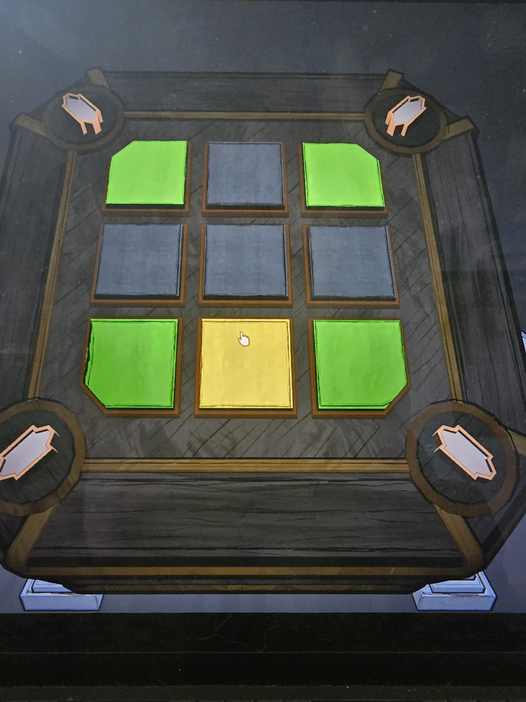

# Mora Jai: Inner Sanctum 1 (вариант Orinda Aries)
Коробка в [Inner Sanctum 1](../../../rooms/the-underpass/inner-sanctum-1/solutions.md): появилась после решения механической загадки с печатью. Символ на угловых кнопках: **ядро Orinda Aries** (вытянутая фигура с выступами). Цель по символу: **чёрные углы** («углы должны быть чёрные»).

## Статус
Решена. На фото положение до решения.

## Положение на фото
Плитки 3×3, сверху вниз, слева направо:
- ряд 1: зелёная, серая, зелёная
- ряд 2: серая, серая, серая
- ряд 3: зелёная, жёлтая, зелёная

Угловые плитки: все четыре зелёные.

## Правило чёрной плитки (из [рекламы](../../../rooms/the-underpass/inner-sanctum-1/docs/mora-jai-box-orinda-aries-advert/ru.md))
**Чёрная плитка**: нажатие сдвигает весь её ряд **вправо**, как по рельсам. (Для варианта Orinda Aries; в самом первом положении чёрных плиток на фото нет.)

## Заметка
- Остальные правила: [Mora Jai](../README.md). Внутри коробки: [Allowance Token](../../../items/allowance-token/ru.md).

## Photos / Фото

