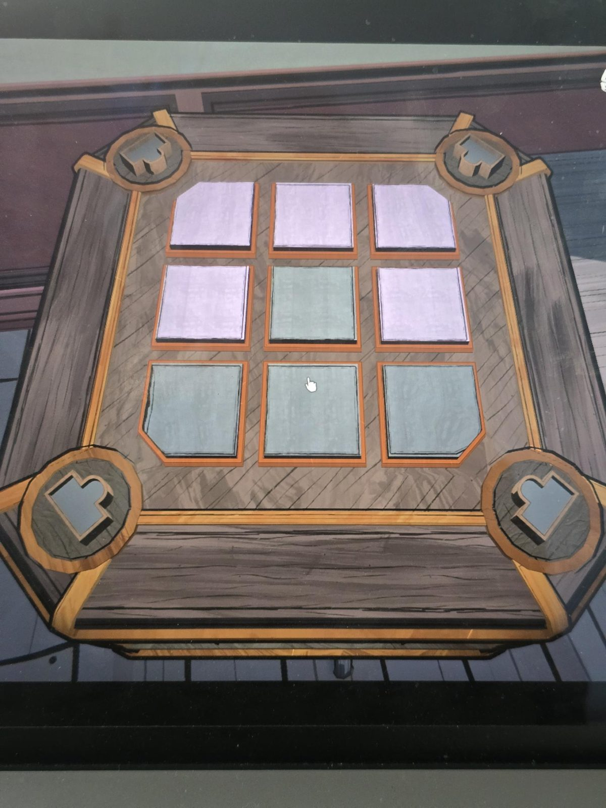

# Mora Jai: Lost & Found
Коробка в [Lost & Found](../../../rooms/lost-and-found/solutions.md) (комната секретного плана этажа). Символ на угловых кнопках: **прямоугольник с кругом**. Цель: **розовый**.

## Статус
Решена. На фото положение до решения.

## Исходное положение (по фото)
Плитки 3×3, сверху вниз, слева направо (на фото цвета бледные: светло-сиреневые и серо-голубые):
- ряд 1: сиреневая, сиреневая, сиреневая
- ряд 2: сиреневая, серо-голубая, сиреневая
- ряд 3: серо-голубая, серо-голубая, серо-голубая

## Заметка
- Правила плиток: [Mora Jai](../README.md).
- Внутри коробки: [Allowance Token](../../../items/allowance-token/ru.md).

## Photos / Фото

