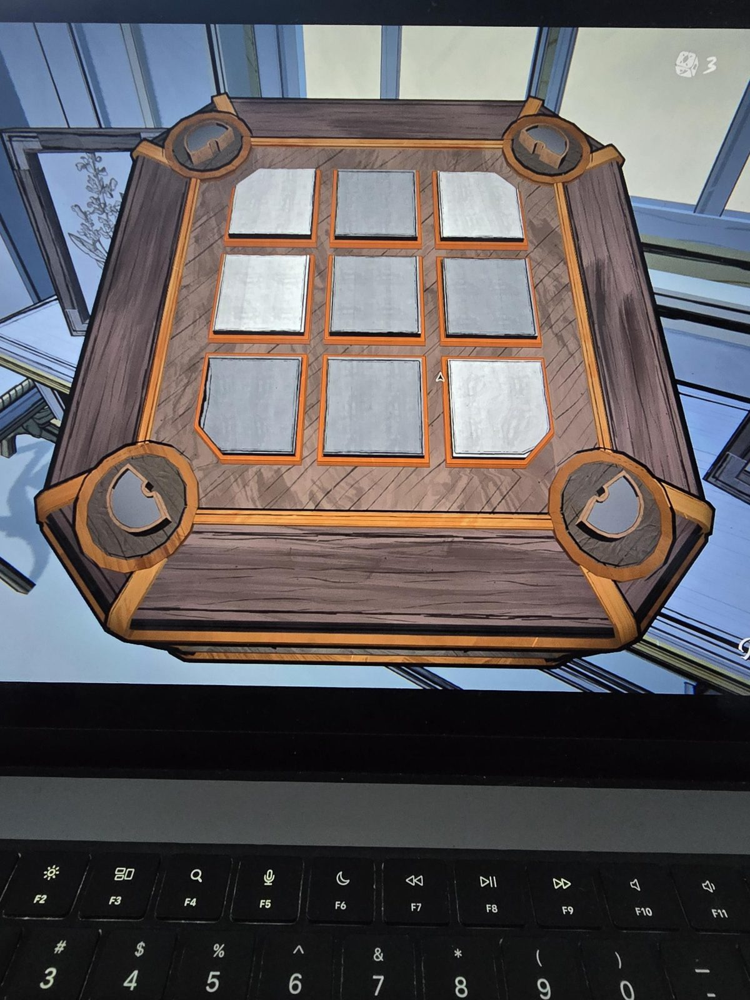

# Mora Jai: Master Bedroom
Коробка в [Master Bedroom](../../../rooms/master-bedroom/solutions.md). Символ на угловых кнопках: **полукруг**; цвет-цель по символу: **белый** («углы должны быть белыми»). Это совпадает с правилом традиционной коробки: [реклама](../../../rooms/master-bedroom/docs/mora-jai-box-advert/ru.md).

## Статус
Решена. На фото положение до решения.

## Исходное положение (по фото, оттенки приблизительные)
Плитки 3×3, сверху вниз, слева направо (светлая = белая):
- ряд 1: белая, серая, белая
- ряд 2: белая, серая, серая
- ряд 3: серая, серая, белая

Угловые плитки: левая верхняя белая, правая верхняя белая, правая нижняя белая, левая нижняя серая (плитки в углах со скошенным краем).

## Заметка
- Правила плиток: [Mora Jai](../README.md).
- Внутри коробки: [Allowance Token](../../../items/allowance-token/ru.md).

## Photos / Фото

