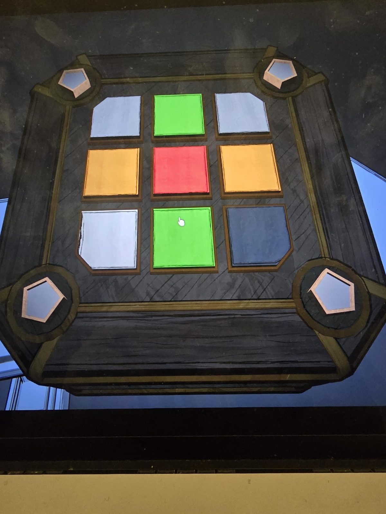

# Mora Jai: Room 46 (вариант Fenn Aries)
Коробка в [Room 46](../../../rooms/room-46/solutions.md). Символ на угловых кнопках: **пятиугольник** (как ядро печати Fenn Aries). Цель по символу: **красные углы**. Правило красной плитки: [реклама варианта Fenn Aries](../../../rooms/the-underpass/inner-sanctum-2/docs/mora-jai-box-fenn-aries-advert/ru.md).

## Статус
Решена. На фото положение до решения.

## Положение на фото
Плитки 3×3, сверху вниз, слева направо:
- ряд 1: белая, зелёная, белая
- ряд 2: оранжевая, красная, оранжевая
- ряд 3: белая, зелёная, тёмная (на вид тёмно-синяя; вероятно, чёрная, это вывод по фото)

Угловые плитки: белая, белая, белая, тёмная.

## Заметка
- Остальные правила: [Mora Jai](../README.md). Внутри коробки: [Allowance Token](../../../items/allowance-token/ru.md).

## Photos / Фото

