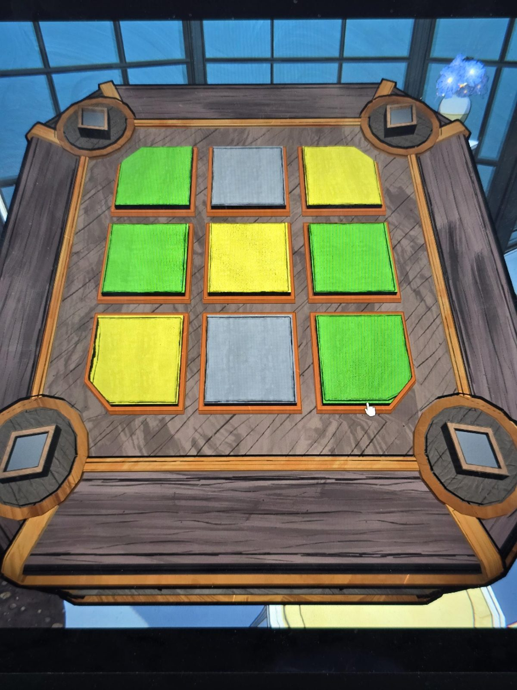

# Mora Jai: Solarium
Коробка в [Solarium](../../../rooms/solarium/solutions.md). Символ на угловых кнопках: **ромбы**. Цель: **зелёный** (углы должны быть зелёными).

## Статус
Решена. На фото положение до решения.

## Исходное положение (по фото)
Плитки 3×3, сверху вниз, слева направо:
- ряд 1: зелёная, серая, жёлтая
- ряд 2: зелёная, жёлтая, зелёная
- ряд 3: жёлтая, серая, зелёная

## Заметка
- Правила плиток: [Mora Jai](../README.md).
- Внутри коробки: [Allowance Token](../../../items/allowance-token/ru.md).

## Photos / Фото

