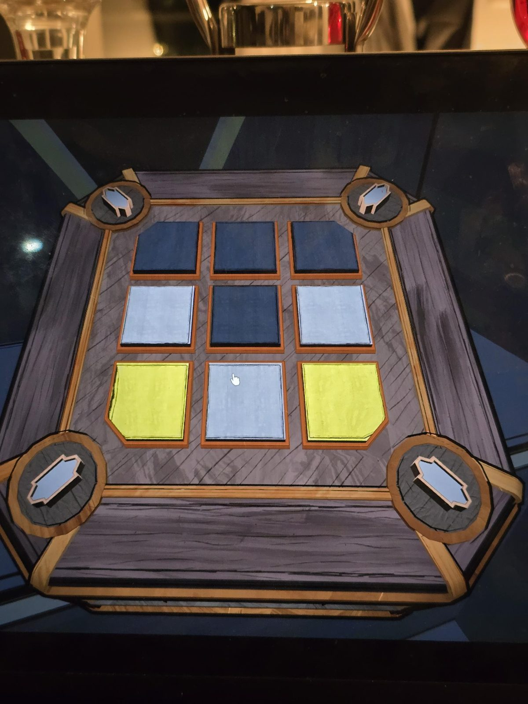

# Mora Jai: The Underpass (вариант Orinda Aries)
Коробка в [The Underpass](../../../rooms/the-underpass/solutions.md). Символ на угловых кнопках: **ядро Orinda Aries** (вытянутая фигура с выступами), такой же, как в [Inner Sanctum 1](../inner-sanctum-1/ru.md). Цель по символу: **чёрные углы**.

## Статус
Решена. На фото положение до решения.

## Положение на фото
Плитки 3×3, сверху вниз, слева направо:
- ряд 1: чёрная, чёрная, чёрная
- ряд 2: светлая, чёрная, светлая
- ряд 3: жёлтая, светлая, жёлтая

## Заметка
- Правила плиток: [Mora Jai](../README.md). Внутри коробки: [Allowance Token](../../../items/allowance-token/ru.md).

## Photos / Фото

