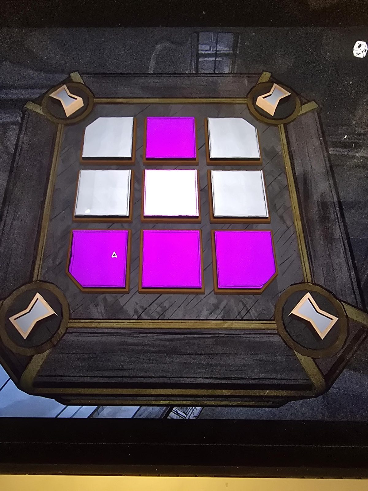

# Mora Jai: Tomb
Коробка в [Tomb](../../../rooms/tomb/solutions.md). Символ на угловых кнопках: **песочные часы** (на [листах Classroom](../../../rooms/classroom/docs/grade-4-geography-worksheets/ru.md) этот знак, по выводу из оценок, у королевства Eraja). Цель по символу: **фиолетовый** («знаки по углам должны быть фиолетовыми»).

## Статус
Решена. На фото положение до решения.

## Исходное положение (по фото)
Плитки 3×3, сверху вниз, слева направо:
- ряд 1: белая, фиолетовая, белая
- ряд 2: белая, белая, белая
- ряд 3: фиолетовая, фиолетовая, фиолетовая

Угловые плитки: верхние две белые, нижние две фиолетовые.

## Заметка
- Правила плиток: [Mora Jai](../README.md).
- Внутри коробки: [Allowance Token](../../../items/allowance-token/ru.md).

## Photos / Фото

