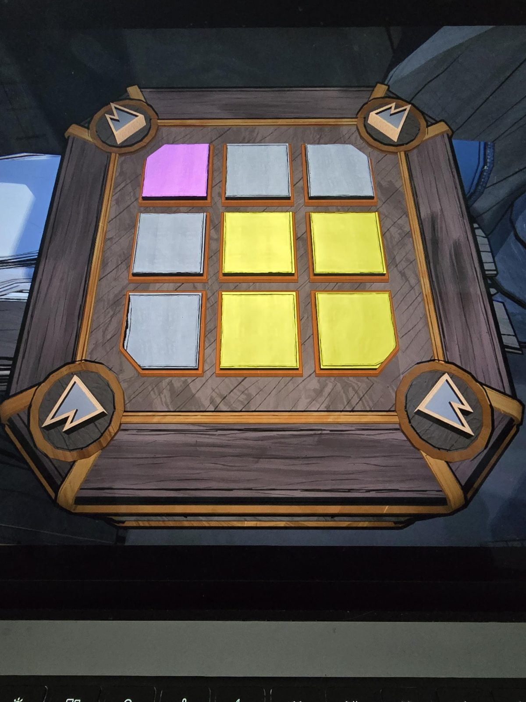

# Mora Jai: Trading Post
Коробка в [Trading Post](../../../rooms/trading-post/solutions.md) (внешняя комната). Символ на угловых кнопках: горы. Цвет по символу: **жёлтый** (со слов пользователя).

## Положение на фото (не решено)
Плитки 3×3, сверху вниз, слева направо:
- ряд 1: розовая, серая, серая
- ряд 2: серая, жёлтая, жёлтая
- ряд 3: серая, жёлтая, жёлтая

Угловые кнопки: по одной в каждом углу, на каждой треугольник с зубцом (горы).

## Заметка
- Внутри коробки: [Allowance Token](../../../items/allowance-token/ru.md).

## Photos / Фото

