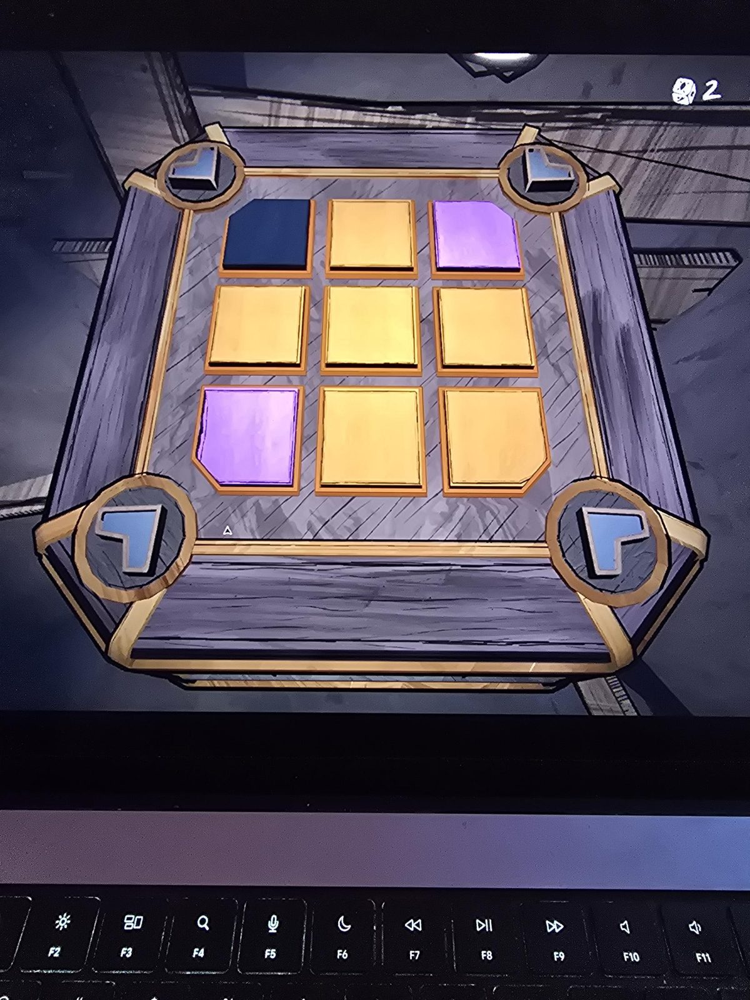

# Mora Jai: Tunnel
Коробка в [Tunnel](../../../rooms/tunnel/solutions.md) (ряд 9). Символ на угловых кнопках: **сердце**. Цель: **оранжевый**.

## Статус
Решена. На фото положение до решения.

## Исходное положение (по фото)
Плитки 3×3, сверху вниз, слева направо:
- ряд 1: чёрная, оранжевая, фиолетовая
- ряд 2: оранжевая, оранжевая, оранжевая
- ряд 3: фиолетовая, оранжевая, оранжевая

## Заметка
- Правила плиток: [Mora Jai](../README.md).
- Внутри коробки: [Allowance Token](../../../items/allowance-token/ru.md).

## Photos / Фото

