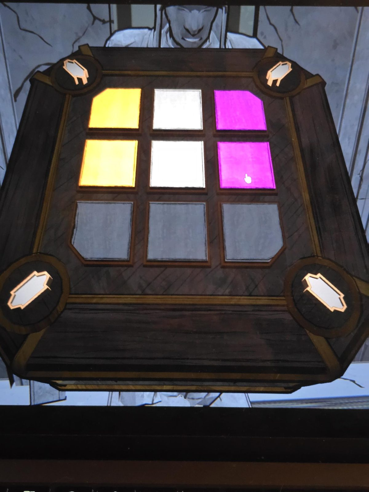
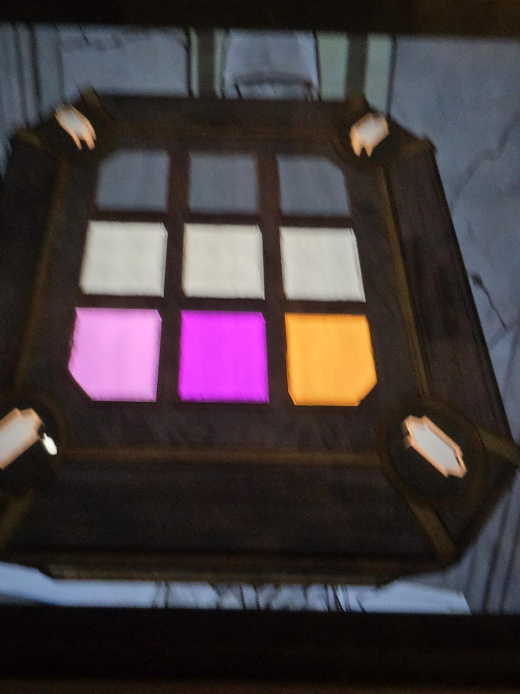
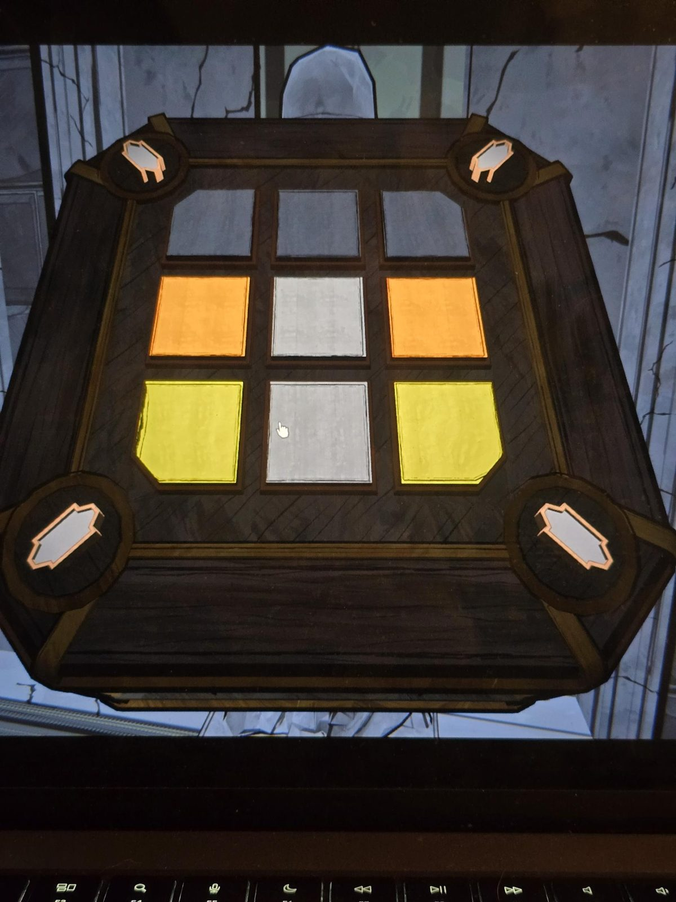
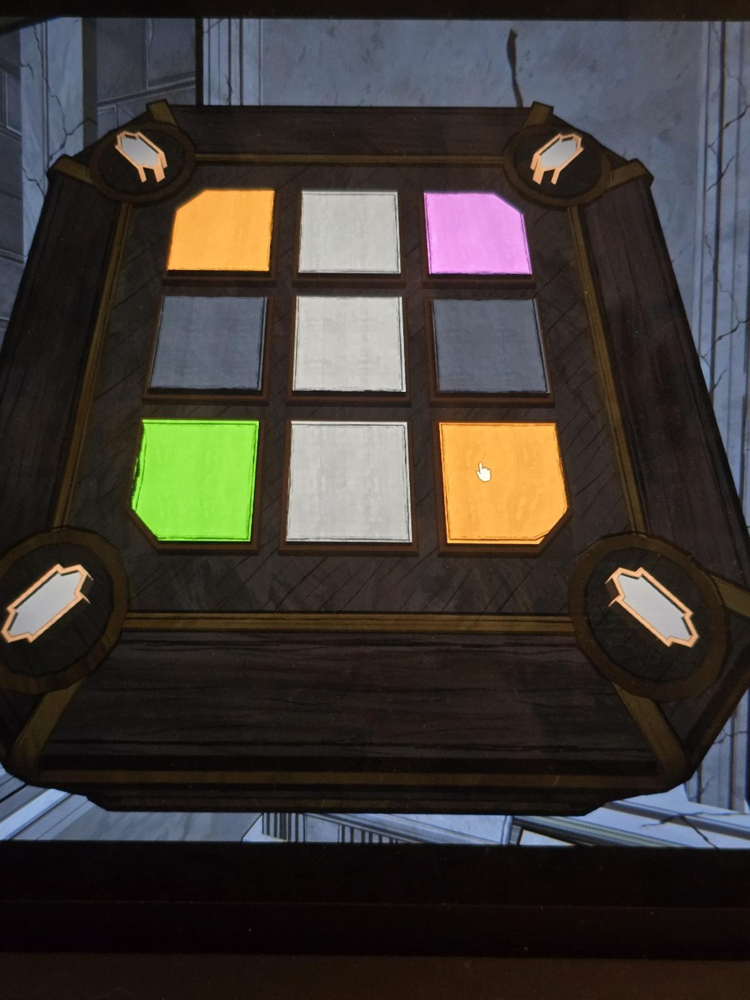

# Mora Jai: Unknown (пять коробок)
Пять статуй в [Unknown](../../../rooms/unknown/solutions.md), каждая держит коробку. Символ на угловых кнопках по виду на фото: вытянутая фигура с выступами, **ядро Orinda Aries** (моё прочтение фото). Цель по символу: **чёрные углы** (мой вывод). Все пять решены; на фото положение до решения. Внутри каждой вместо [Allowance Token](../../../items/allowance-token/ru.md) лежит записка: [стих](../../../rooms/unknown/docs/statues-poem/ru.md).

## Положение на фото
Плитки 3×3, сверху вниз, слева направо. «Тёмная» — тёмная плитка на фото (чёрная).

**1** (записка «In Aries Court…», [01.jpg](01.jpg)):
- ряд 1: тёмная, тёмная, тёмная
- ряд 2: зелёная, тёмная, светлая
- ряд 3: светлая, светлая, розовая

**2** (записка «On the sacred hour…», [02.jpg](02.jpg)):
- ряд 1: жёлтая, светлая, розовая
- ряд 2: жёлтая, светлая, розовая
- ряд 3: тёмная, тёмная, тёмная

**3** (записка «Will a youth…», [03.jpg](03.jpg), снимок смазан):
- ряд 1: тёмная, тёмная, тёмная
- ряд 2: светлая, светлая, светлая
- ряд 3: светло-розовая, розовая, оранжевая

**4** (записка «Without gifts…», [04.jpg](04.jpg)):
- ряд 1: тёмная, тёмная, тёмная
- ряд 2: оранжевая, светлая, оранжевая
- ряд 3: жёлтая, светлая, жёлтая

**5** (записка «And in sky…», [05.jpg](05.jpg)):
- ряд 1: оранжевая, светлая, розовая
- ряд 2: тёмная, светлая, тёмная
- ряд 3: зелёная, светлая, оранжевая

## Заметка
- Правила плиток: [Mora Jai](../README.md).

## Photos / Фото
    
