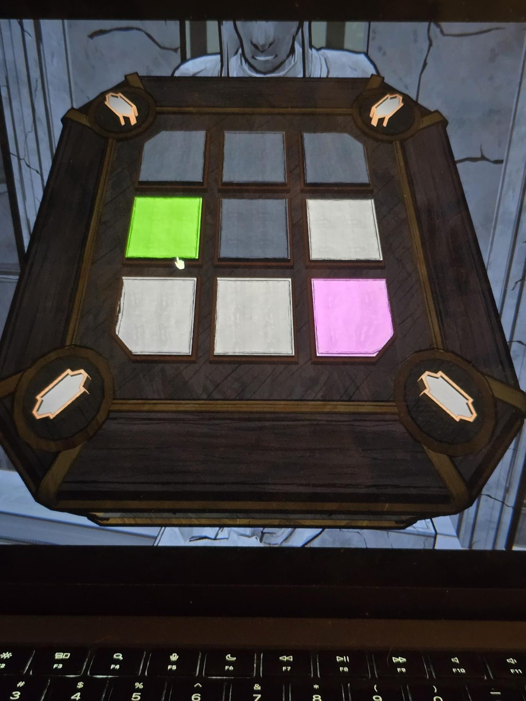

# Mora Jai: Unknown
Коробка в [Unknown](../../../rooms/unknown/solutions.md) (в руках статуи). Символ на угловых кнопках по виду на фото: вытянутая фигура с выступами, **ядро Orinda Aries** (это моё прочтение фото). Цель по символу: **чёрные углы** (тоже мой вывод).

## Статус
Решена. На фото положение до решения.

## Положение на фото
Плитки 3×3, сверху вниз, слева направо:
- ряд 1: тёмные (чёрные), тёмные, тёмные
- ряд 2: зелёная, тёмная, светлая
- ряд 3: светлая, светлая, розовая

## Заметка
- Правила плиток: [Mora Jai](../README.md). Внутри коробки вместо [Allowance Token](../../../items/allowance-token/ru.md) лежит [записка](../../../rooms/unknown/docs/aries-court-note/ru.md).

## Photos / Фото

