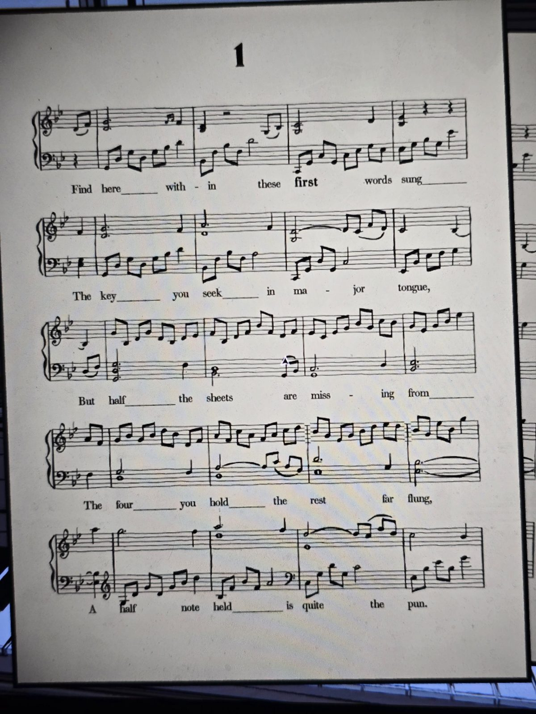

# Ноты №1
Найдите здесь, в этих **первых** спетых словах,
Ключ, что ищете, на мажорном языке,
Но половины листов недостаёт
Из четырёх, что у вас, — остальные далеко,
Удержанная половинная нота — вот каламбур.
Найдены: **Music Room** (листы 1–4 лежат вместе).

## Заметка
- Жирное слово: **first**. «Четыре у вас, остальные далеко» — листы 1–4 лежат вместе, 5–8 разбросаны.

## Photos / Фото

