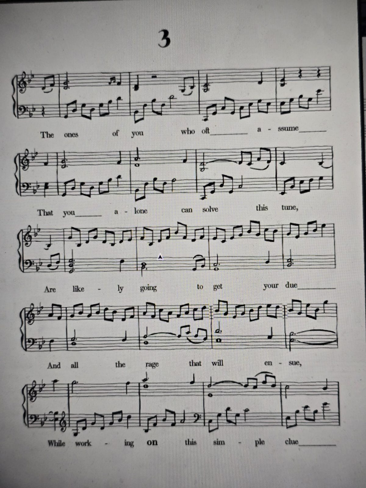

# Ноты №3
Найдены: **Music Room** (листы 1–4 лежат вместе).

Те из вас, кто часто полагает,
Что лишь вы одни решите эту мелодию,
Скорее всего, получат по заслугам —
И всю ярость, что последует, —
Работая **над** этой простой подсказкой.

## Заметка
- Жирное слово: **on**.

## Photos / Фото

