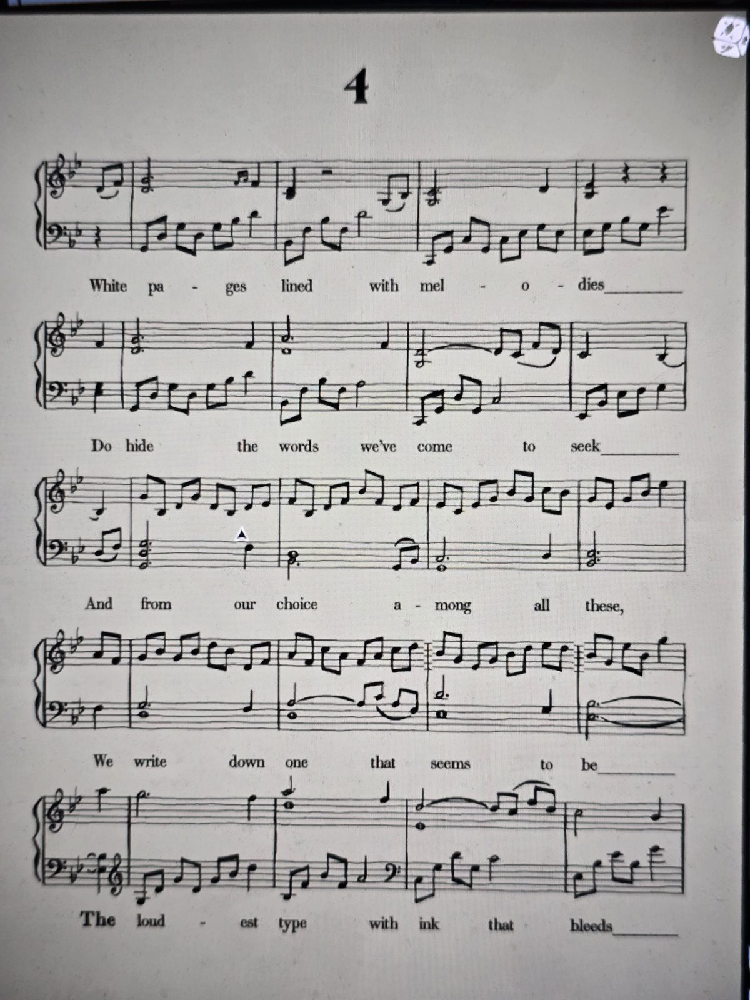

# Ноты №4
Белые страницы, расчерченные мелодиями,
Скрывают слова, что мы пришли искать,
И из всех них мы выбираем
И записываем одно, что кажется
Самым громким шрифтом с проступающими чернилами.
Найдены: **Music Room** (листы 1–4 лежат вместе).

## Заметка
- Жирное слово: **The**. «Самый громкий шрифт» = жирный.

## Photos / Фото

