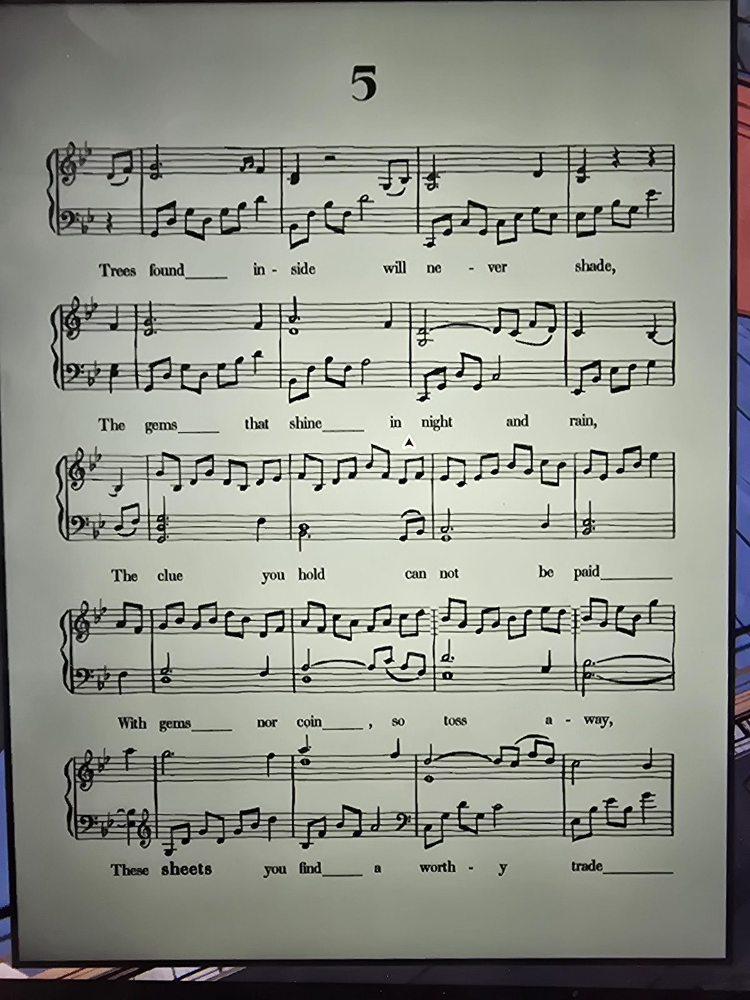

**5**

*(Piano score in B♭.)*

Trees found inside will never shade,
The gems that shine in night and rain,
The clue you hold can not be paid
With gems nor coin, so toss away,
These **sheets** you find a worthy trade

## Photos / Фото

