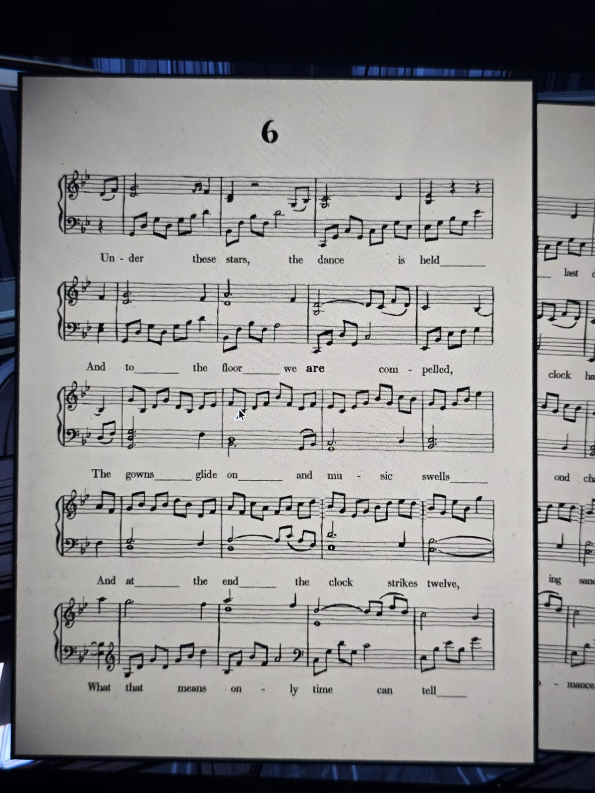

# Ноты №6
Найдены: Ballroom.

Под этими звёздами идёт танец,
И на паркет нас **тянет** (are compelled),
Платья скользят, и музыка нарастает,
А в конце часы бьют двенадцать,
Что это значит — покажет лишь время.

## Заметка
- Жирным выделено слово **are**.

## Photos / Фото

