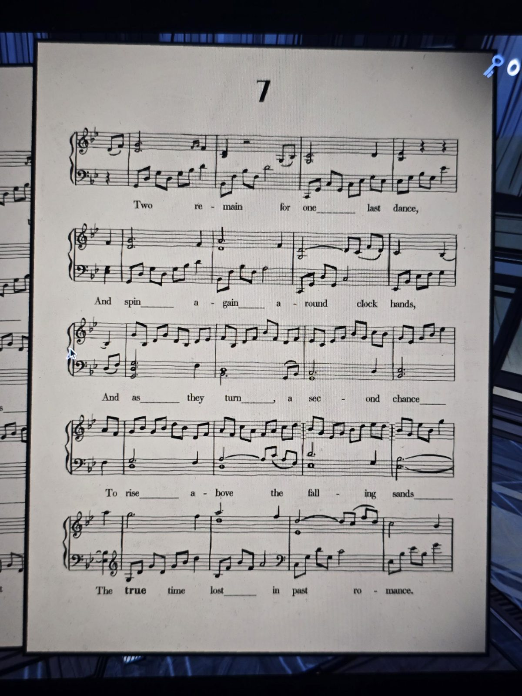

**7**

*(Piano score in B♭.)*

Two remain for one last dance,
And spin again around clock hands,
And as they turn, a second chance
To rise above the falling sands
The **true** time lost in past romance.

## Photos / Фото

