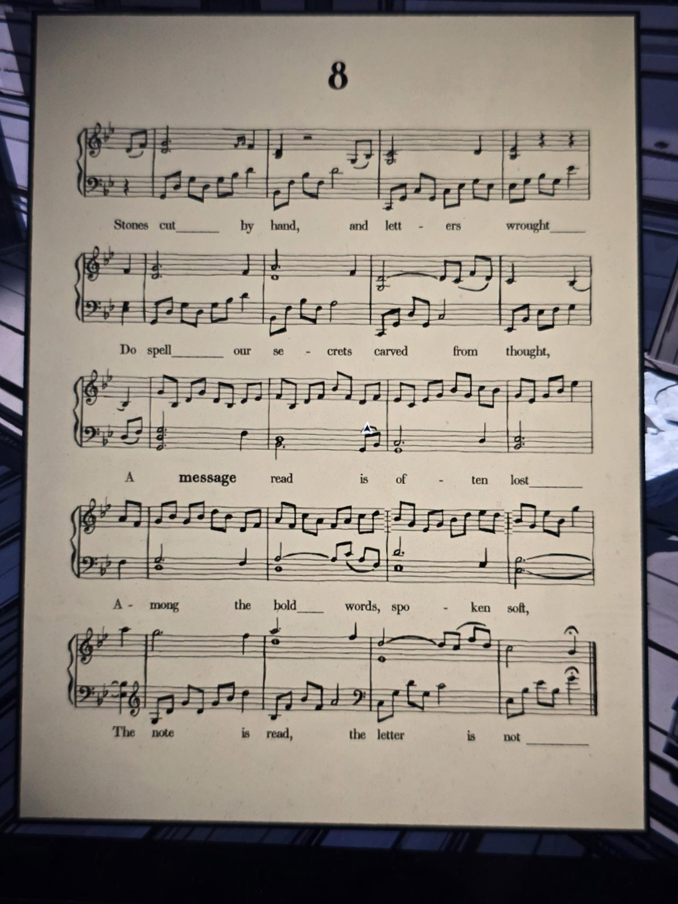

# Ноты №8
Найдены: Workshop (лежат на верстаке рядом с камнем «S»).

Камни, вырезанные рукой, и буквы, выкованные,
Складывают наши тайны, высеченные из мыслей.
Прочитанное **послание** часто теряется
Среди громких слов, сказанных тихо.
Нота прочитана, буква — нет.

## Заметка
- Слово **message** выделено жирным.
- «Stones cut by hand, letters wrought» — камни с буквами (как камень S в Workshop).
- «The note is read, the letter is not» — возможно, надо читать названия нот (буквы A–G) в мелодии, а не текст.

## Photos / Фото

