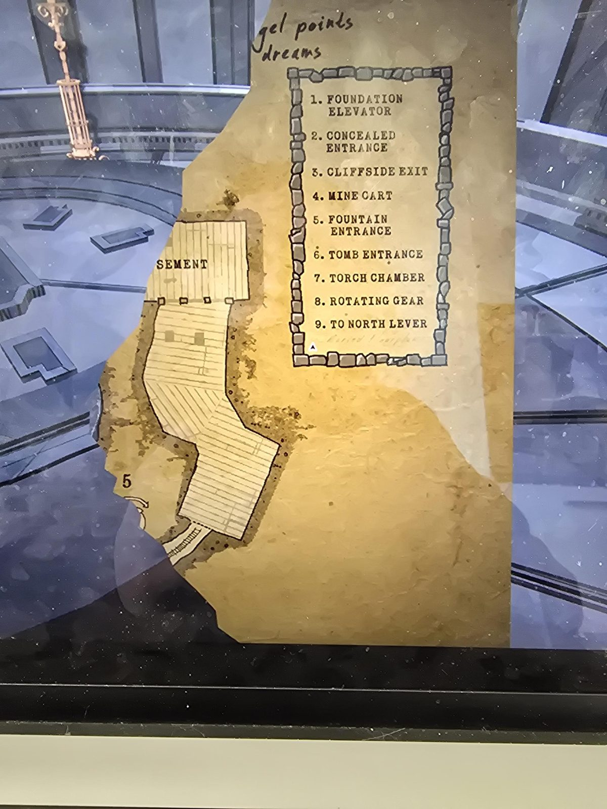

**UNDERGROUND MAP** *(torn fragment, right part)*

Handwritten at the torn top edge: "…gel points / dreams" (cut off)

Legend:
1. FOUNDATION ELEVATOR
2. CONCEALED ENTRANCE
3. CLIFFSIDE EXIT
4. MINE CART
5. FOUNTAIN ENTRANCE
6. TOMB ENTRANCE
7. TORCH CHAMBER
8. ROTATING GEAR
9. TO NORTH LEVER

Map: BASEMENT (partly torn, "…SEMENT"), a long wooden-floored passage going down, number 5, track at the bottom.

## Photos / Фото

