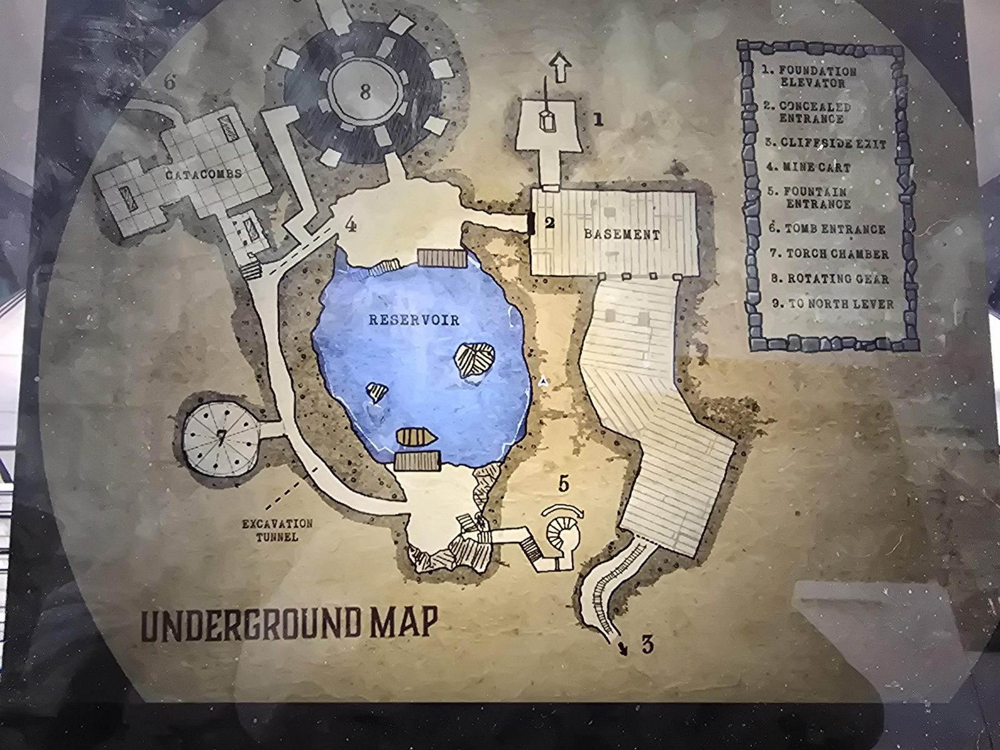
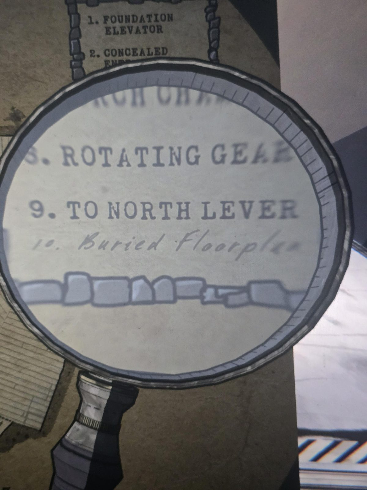
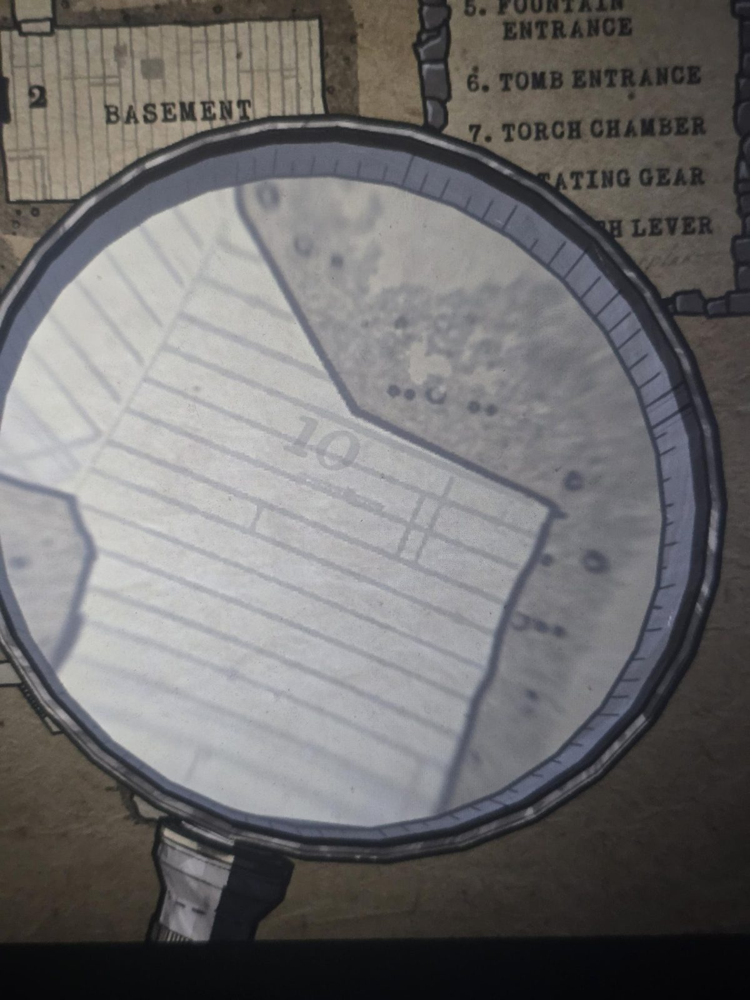

# Подземная карта (полная)
Найдена на дальней стороне Reservoir (переправа на лодке при уровне воды 13). Мелкий шрифт под пунктом 9 легенды: «**Buried floorplan**» (через лупу).

**Что на карте:**
- **Basement** (подвал) с **2 — скрытым входом**; над ним **1 — Foundation Elevator**.
- Из подвала длинный деревянный проход вниз к **5 — Fountain Entrance** (винтовой спуск) и дальше к **3 — Cliffside Exit** (рельсы, стрелка).
- **Reservoir** с двумя островками, лодкой и двумя причалами (северный и южный).
- **Catacombs** слева вверху, рядом **6 — Tomb Entrance**.
- **8 — Rotating Gear**: круглая комната с зубцами вверху.
- **7 — Torch Chamber** слева от туннеля; **Excavation Tunnel** — длинный туннель вдоль западного берега.
- **4 — Mine Cart** (вагонетка) на пути между Catacombs и Reservoir; **9 — To North Lever** (стрелка вверху над лифтом).

## Пункт 10: Buried Floorplan (через лупу)
- В легенде под пунктом 9 «To North Lever» мелким рукописным шрифтом: **«10. Buried Floorplan»** ([фото 2](02.jpg)). Рядом видны 1. Foundation Elevator, 2. Concealed Entrance, 8. Rotating Gear.
- На самой карте цифра **10** стоит **в районе Basement**, в деревянной части плана, под ней мелкая подпись (нечитаема) ([фото 3](03.jpg)). Со слов пользователя, это положение «Buried plan» в [Basement](../../../../basement/solutions.md).
- Надпись «2» у Basement на карте, по легенде, **Concealed Entrance** (скрытый вход).
- Не проверено: связано ли это с [разбивающейся стеной в Basement](../../../../basement/solutions.md); что именно спрятано (секретный план этажа?).
- **9 — To North Lever**: ср. [North lever (underground) в схеме Antechamber](../../../../basement/docs/antechamber-entry-controls/ru.md).

## Заметка
- Части той же карты: [фрагмент в Catacombs](../../../../catacombs/docs/underground-map-fragment/ru.md), [фрагмент 2](../../../docs/underground-map-fragment-2/ru.md).

## Photos / Фото

