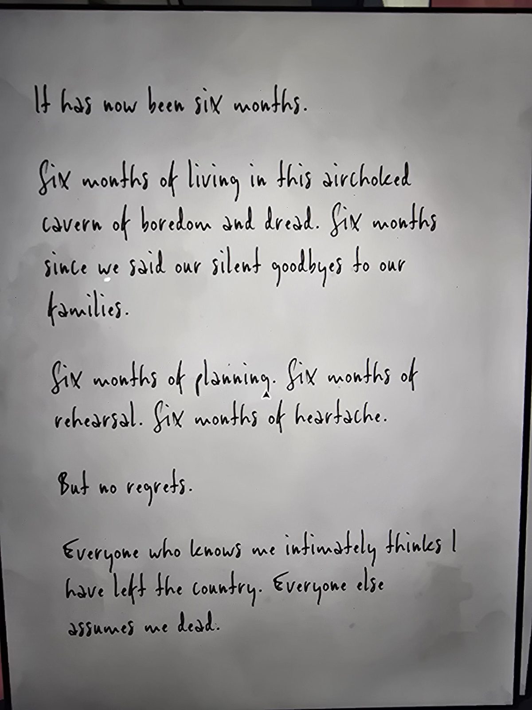
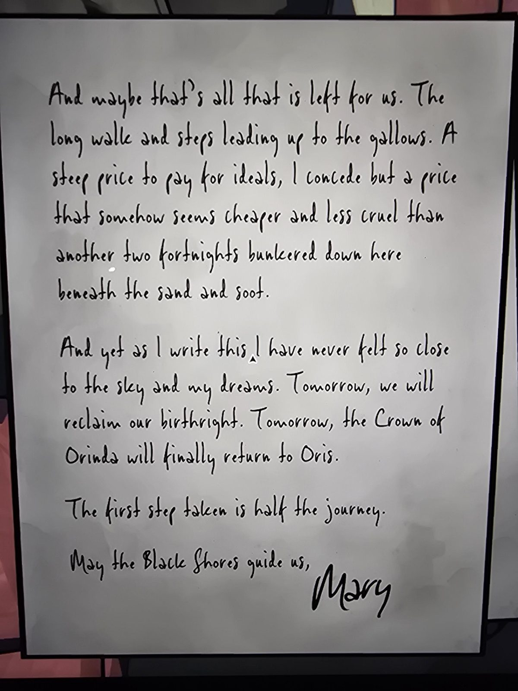

# Letter from Mary (Safehouse)

It has now been six months.

Six months of living in this airchoked cavern of boredom and dread. Six months since we said our silent goodbyes to our families.

Six months of planning. Six months of rehearsal. Six months of heartache.

But no regrets.

Everyone who knows me intimately thinks I have left the country. Everyone else assumes me dead.

And maybe that's all that is left for us. The long walk and steps leading up to the gallows. A steep price to pay for ideals, I concede but a price that somehow seems cheaper and less cruel than another two fortnights bunkered down here beneath the sand and soot.

And yet as I write this I have never felt so close to the sky and my dreams. Tomorrow, we will reclaim our birthright. Tomorrow, the Crown of Orinda will finally return to Oris.

The first step taken is half the journey.

May the Black Shores guide us,
Mary

## Photos / Фото

