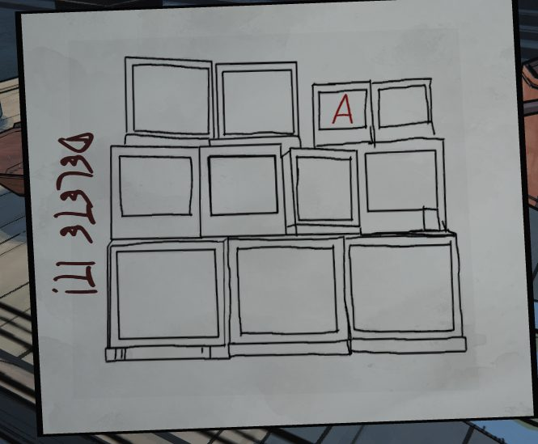

# Заметка с мониторами: «DELETE IT!!» (Safehouse)
Safehouse. Рисунок: стопка из 11 мониторов (3 больших внизу, 4 посередине, 4 меньших сверху). На третьем экране верхнего ряда красная буква **A**, остальные экраны пустые. Слева вертикально тёмно-красным надпись **«DELETE IT!!»** («Удали это!!»).

## Заметка
- Похоже на мониторы в [Security](../../../../security/solutions.md); та же заметка есть там: [Заметка с мониторами](../../../../security/docs/monitors-delete-it-sketch/ru.md). Нужно будет посмотреть, что показывают мониторы в Security.

## Photos / Фото

