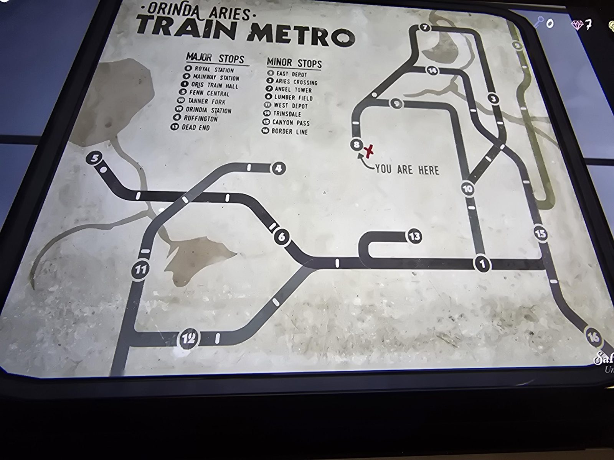

# Orinda Aries Train Metro

ORINDA ARIES TRAIN METRO

MAJOR STOPS
- Royal Station
- Mainway Station
- Oris Train Hall
- Fenn Central
- Tanner Fork
- Orindia Station
- Ruffington
- Dead End

MINOR STOPS
- East Depot
- Aries Crossing
- Angel Tower
- Lumber Field
- West Depot
- Trinsdale
- Canyon Pass
- Border Line

Map: 16 numbered stops on dark lines. Red X at stop 8, "YOU ARE HERE".

## Photos / Фото

