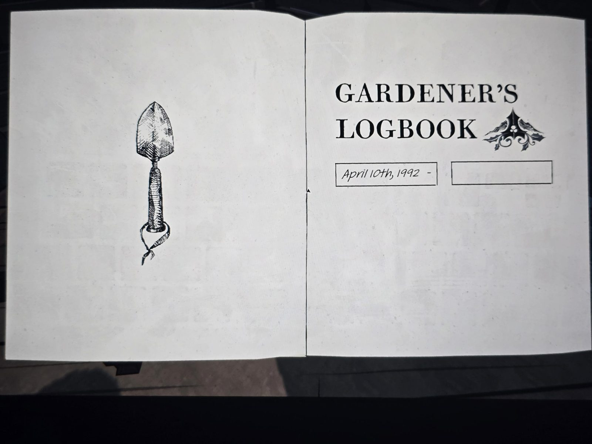
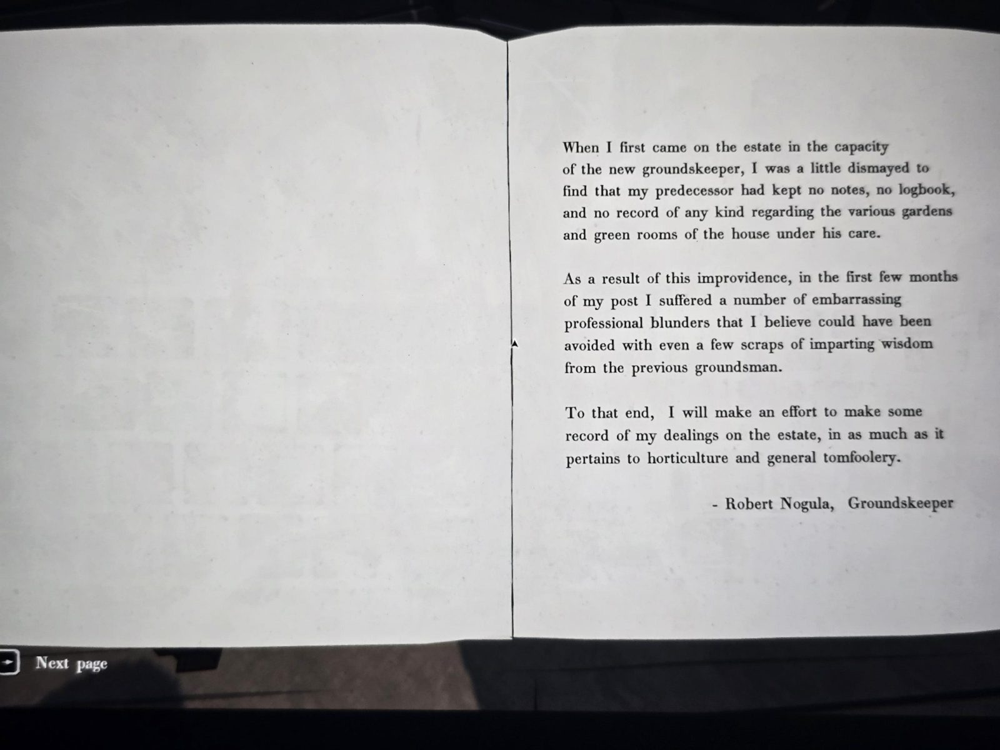
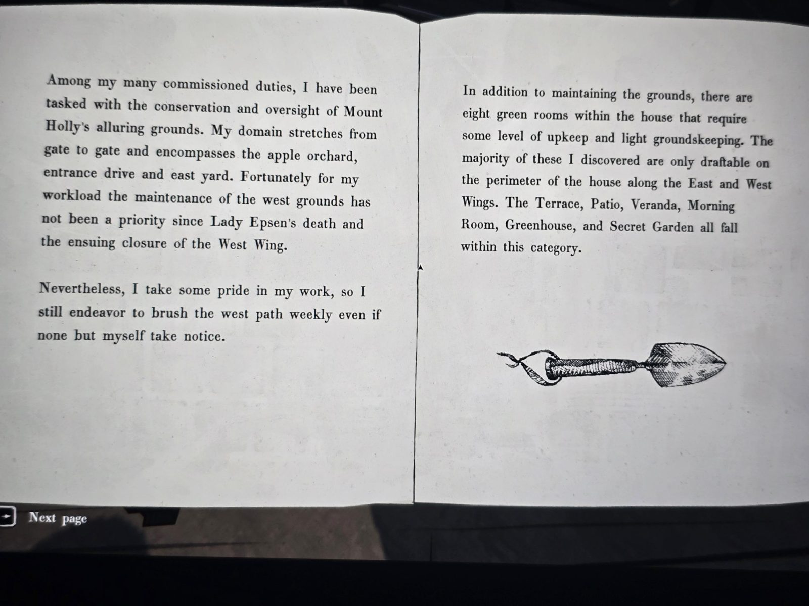
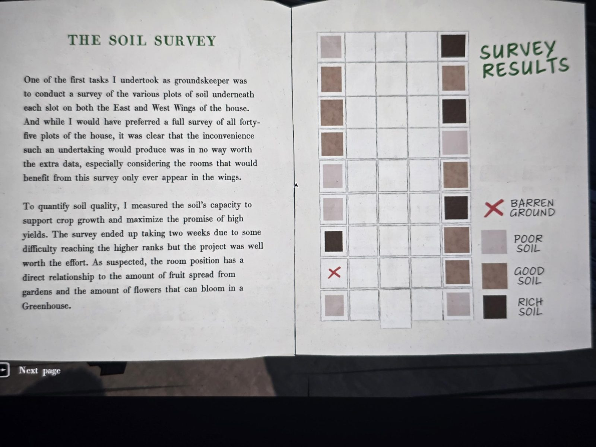
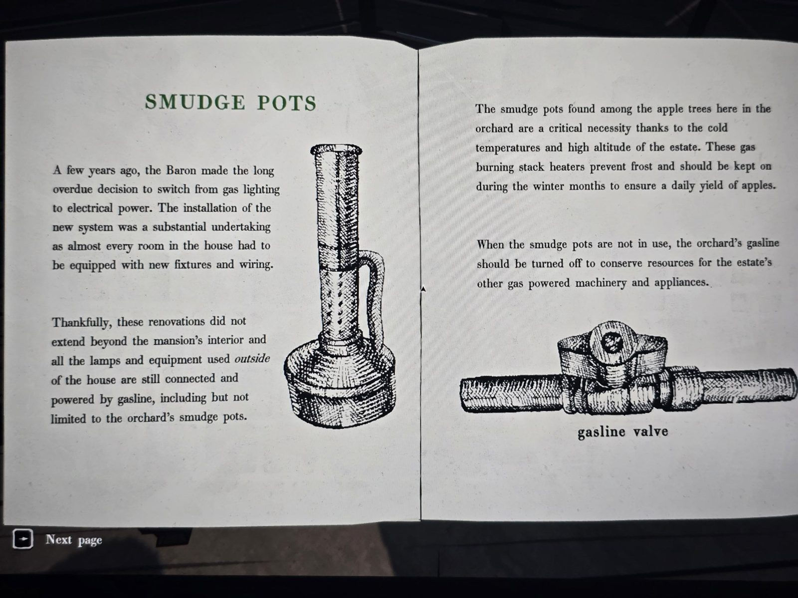
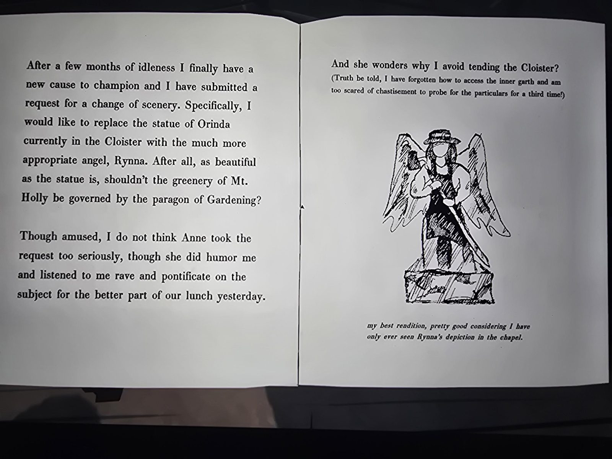

# Журнал садовника (Gardener's Logbook)
Книга в Apple Orchard (яблоневый сад, зона снаружи особняка). Начат **10 апреля 1992**, дата окончания не заполнена.

### Вступление
Когда я пришёл в поместье новым **смотрителем территории**, меня несколько огорчило, что мой предшественник не оставил ни заметок, ни журнала, ни каких-либо записей о садах и «зелёных комнатах» дома. Из-за этого в первые месяцы я допустил несколько неловких профессиональных промахов, которых можно было бы избежать. Поэтому я постараюсь вести записи о своей работе в поместье — о садоводстве и всяком дурачестве.
— **Роберт Ногула**, смотритель территории

### Территория и зелёные комнаты
Моя зона — от ворот до ворот: **яблоневый сад**, подъездная аллея и **восточный двор**. Западную территорию после смерти **леди Эпсен** и закрытия западного крыла поддерживать не обязательно, но я всё равно раз в неделю подметаю **западную дорожку**.

В доме **восемь зелёных комнат**, требующих ухода. Большинство из них можно вытянуть **только по краю дома, вдоль восточного и западного крыльев**: **Terrace, Patio, Veranda, Morning Room, Greenhouse, Secret Garden**.

### Обследование почвы
Я обследовал почву под каждой клеткой **восточного и западного крыльев** (не все 45 клеток — эти комнаты всё равно бывают только в крыльях). Оказалось, что **положение комнаты напрямую влияет** на количество фруктов, которые «разбрасывают» сады, и на число цветов в **Greenhouse**.

**Результаты** (ряд 9 сверху, ряд 1 снизу):

| Ряд | Запад (столбец 1) | Восток (столбец 5) |
|---|---|---|
| 9 | бедная | **богатая** |
| 8 | хорошая | хорошая |
| 7 | хорошая | **богатая** |
| 6 | хорошая | бедная |
| 5 | бедная | хорошая |
| 4 | бедная | **богатая** |
| 3 | **богатая** | хорошая |
| 2 | ❌ бесплодная | хорошая |
| 1 | бедная | бедная |

### Дымовые горелки (smudge pots)
Несколько лет назад барон перевёл дом с газового освещения на электричество. Но всё, что **снаружи** дома, по-прежнему работает **на газу**, включая горелки в саду. Горелки защищают яблони от заморозков и зимой должны быть включены, чтобы каждый день был урожай яблок. Когда горелки не нужны, **газ в саду надо перекрывать** (вентиль), чтобы экономить его для других газовых машин поместья.

### Статуя в Cloister
Я подал просьбу заменить статую **Ориндa** в **Cloister** на ангела **Рынну** — покровительницу садоводства. **Энн** выслушала меня за обедом, но, кажется, всерьёз не восприняла. (Честно говоря, я забыл, как попасть во **внутренний двор (garth) Cloister**, а спросить в третий раз боюсь!)

*(Рисунок: крылатая фигура в шляпе с мотыгой — «видел Рынну только на витраже в часовне».)*

## Заметка
- **Рынна** = витраж **I** (садовник с мотыгой) в [Chapel](../../../chapel/docs/stained-glass/ru.md). Значит, витражи — **ангелы-покровители профессий** с именами. Статуэтка **MILA** (горничная с метлой) — вероятно, ангел витража V.
- **Орина́да** — ср. «Рубиновая корона **Ориндa Эрис**» в газете ([Archives](../../../archives/docs/newspaper-clippings-album/ru.md)): статуя в Cloister, видимо, королевы/святой Ориндa.
- Таблица почвы: где ставить Greenhouse и сады для максимума (богатая почва: запад 3; восток 9, 7, 4).
- Новые персонажи: **Роберт Ногула** (садовник с 1992), **Энн**.
- Газ снаружи: вентили зажигают огни перед особняком (см. [четыре огня](../../../../puzzles/gas-flames.md)).

## Photos / Фото

