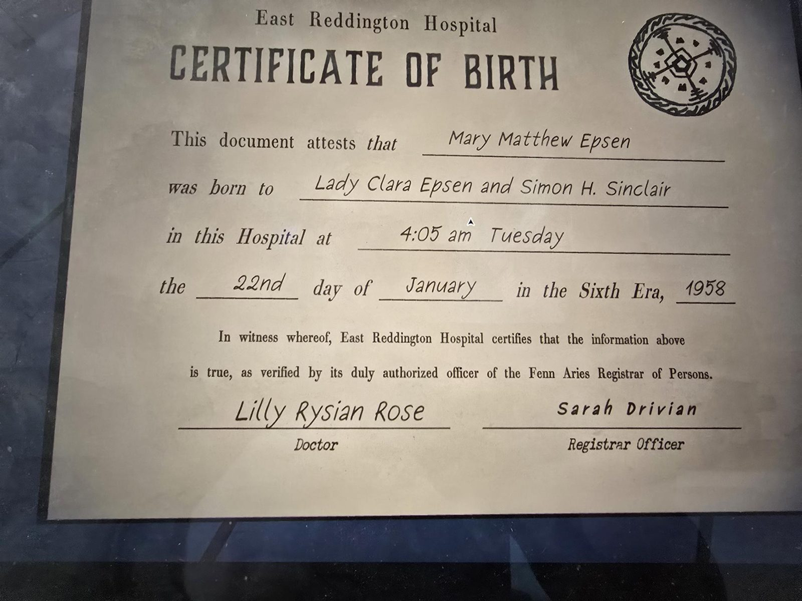

East Reddington Hospital
CERTIFICATE OF BIRTH

*(Round seal at top right: Fenn Aries crest.)*

This document attests that Mary Matthew Epsen
was born to Lady Clara Epsen and Simon H. Sinclair
in this Hospital at 4:05 am Tuesday
the 22nd day of January in the Sixth Era, 1958

In witness whereof, East Reddington Hospital certifies that the information above is true, as verified by its duly authorized officer of the Fenn Aries Registrar of Persons.

Lilly Rysian Rose — Doctor
Sarah Drivian — Registrar Officer

*(The filled-in fields are in a handwriting-style font.)*

## Photos

