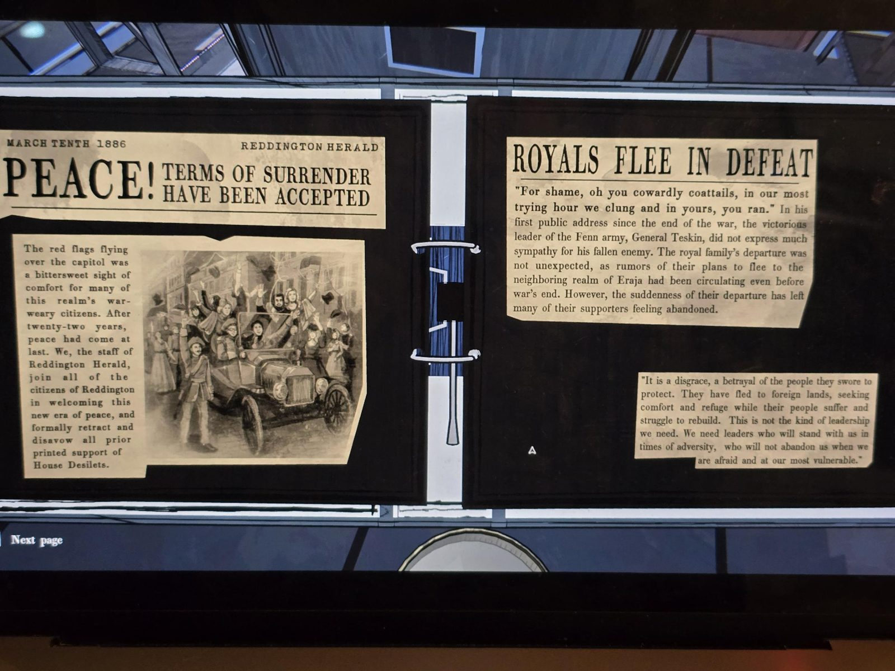
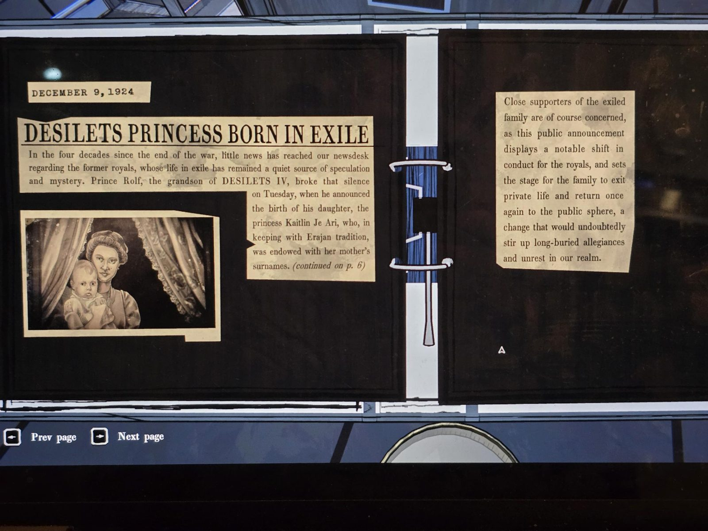
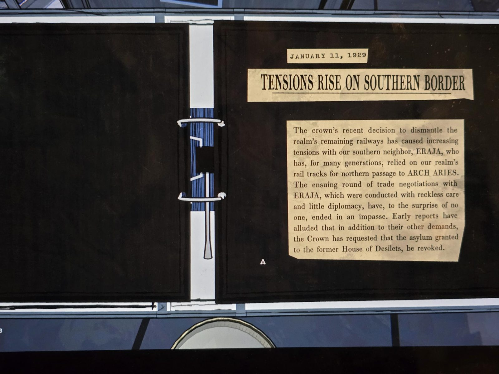
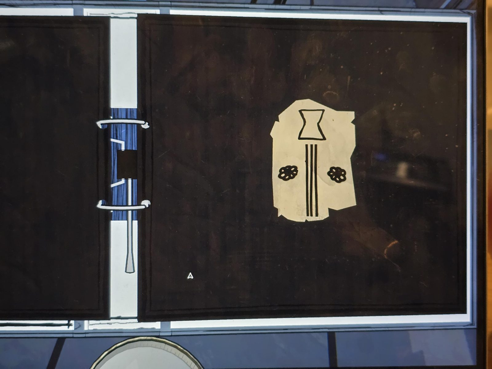

# Clippings folder (Archives): the Desilets family
Ring binder, 4 spreads (Next page).

## Spread 1
**MARCH TENTH 1886 — REDDINGTON HERALD**
**PEACE! TERMS OF SURRENDER HAVE BEEN ACCEPTED**
The red flags flying over the capitol was a bittersweet sight of comfort for many of this realm's war-weary citizens. After twenty-two years, peace had come at last. We, the staff of Reddington Herald, join all of the citizens of Reddington in welcoming this new era of peace, and formally retract and disavow all prior printed support of House Desilets.
*(Photo: a crowd cheering around an open car.)*

**ROYALS FLEE IN DEFEAT**
"For shame, oh you cowardly coattails, in our most trying hour we clung and in yours, you ran." In his first public address since the end of the war, the victorious leader of the Fenn army, General Teskin, did not express much sympathy for his fallen enemy. The royal family's departure was not unexpected, as rumors of their plans to flee to the neighboring realm of Eraja had been circulating even before war's end. However, the suddenness of their departure has left many of their supporters feeling abandoned.

"It is a disgrace, a betrayal of the people they swore to protect. They have fled to foreign lands, seeking comfort and refuge while their people suffer and struggle to rebuild. This is not the kind of leadership we need. We need leaders who will stand with us in times of adversity, who will not abandon us when we are afraid and at our most vulnerable."

## Spread 2
**DECEMBER 9, 1924**
**DESILETS PRINCESS BORN IN EXILE**
In the four decades since the end of the war, little news has reached our newsdesk regarding the former royals, whose life in exile has remained a quiet source of speculation and mystery. Prince Rolf, the grandson of DESILETS IV, broke that silence on Tuesday, when he announced the birth of his daughter, the princess Kaitlin Je Ari, who, in keeping with Erajan tradition, was endowed with her mother's surnames. *(continued on p. 6)*
*(Photo: a woman with a baby between curtains.)*

Close supporters of the exiled family are of course concerned, as this public announcement displays a notable shift in conduct for the royals, and sets the stage for the family to exit private life and return once again to the public sphere, a change that would undoubtedly stir up long-buried allegiances and unrest in our realm.

## Spread 3
**JANUARY 11, 1929**
**TENSIONS RISE ON SOUTHERN BORDER**
The crown's recent decision to dismantle the realm's remaining railways has caused increasing tensions with our southern neighbor, ERAJA, who has, for many generations, relied on our realm's rail tracks for northern passage to ARCH ARIES. The ensuing round of trade negotiations with ERAJA, which were conducted with reckless care and little diplomacy, have, to the surprise of no one, ended in an impasse. Early reports have alluded that in addition to their other demands, the Crown has requested that the asylum granted to the former House of Desilets, be revoked.

## Spread 4
A torn scrap of paper glued to the page: a sigil drawing, no text. Hourglass at the top, three vertical lines below it, two flower-like marks on the sides.

## Photos / Фото

