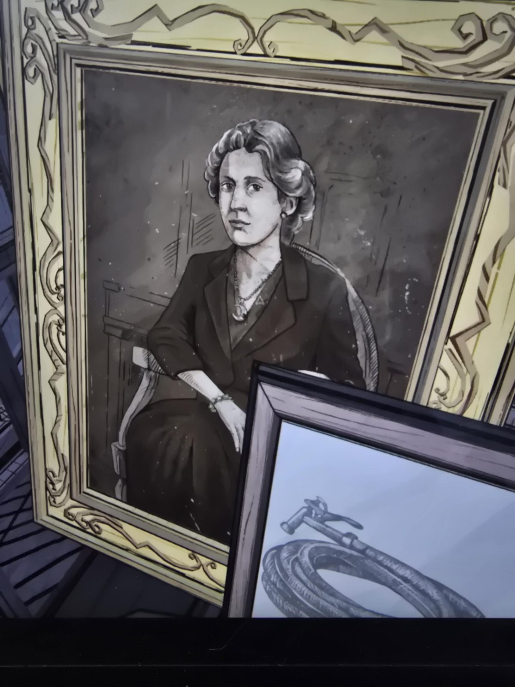

# Портрет баронессы (подвеска-луна)
Attic. Портрет сидящей женщины в тёмном жакете и платье, на длинной цепочке подвеска-**полумесяц**, браслет на запястье. На воротнике виден маленький знак, похожий на букву «A» (неразборчиво). Спереди стоит другая рамка с рисунком **свёрнутого садового шланга с насадкой**.

## Заметка
- По словам пользователя, это **баронесса** (**Ауравей**, жена барона Томаса Синклера; см. [семейное древо](../../../root-cellar/docs/mount-holly-family-tree/ru.md)). Ср. [портрет женщины с подвеской-луной в Bedroom](../../../bedroom/docs/portrait-woman-moon-pendant/ru.md) и знак луны в [Inner Sanctum](../../../the-underpass/inner-sanctum.md).
- Шланг в передней рамке: зачем он здесь, не ясно.

## Photos / Фото

