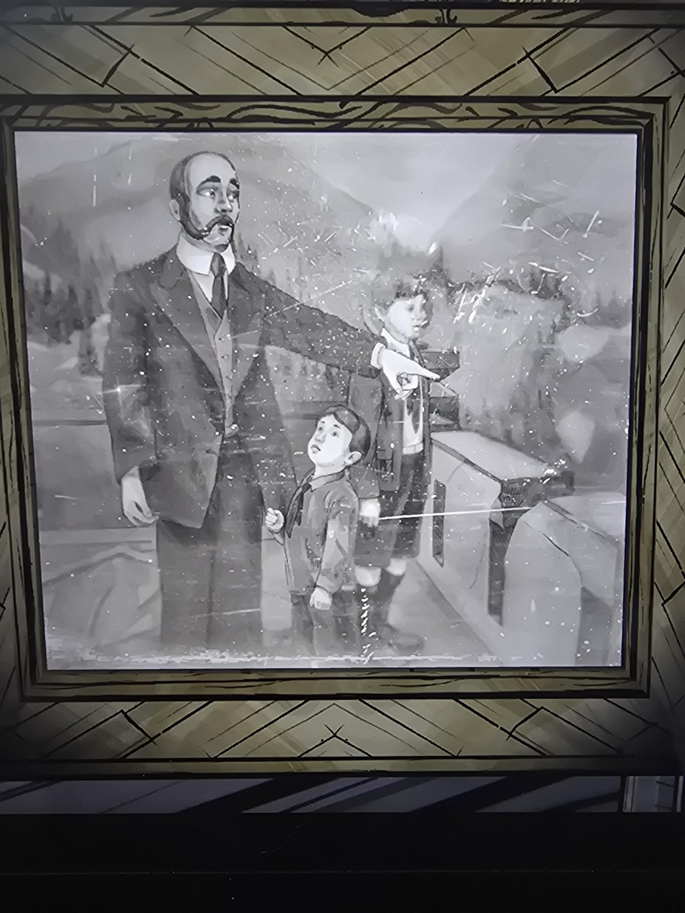

# Фото: мужчина с двумя мальчиками
Attic. Чёрно-белая потёртая картина в раме: лысеющий мужчина с бородкой и усами в костюме с жилетом **показывает рукой вдаль**; рядом два мальчика: младший смотрит на него снизу вверх и держится за руку, старший в шортах и ботинках. Позади горы и ёлки, справа каменный парапет.

## Заметка
- По словам пользователя, **предположительно Герберт, его брат и отец**: то есть отец **барон Томас Синклер** и сыновья **Герберт** и **Саймон Х. Синклер** ([семейное древо](../../../root-cellar/docs/mount-holly-family-tree/ru.md)). Кто из мальчиков кто, не установлено; **догадка, не проверено**.
- Подписи на картине нет.

## Photos / Фото

