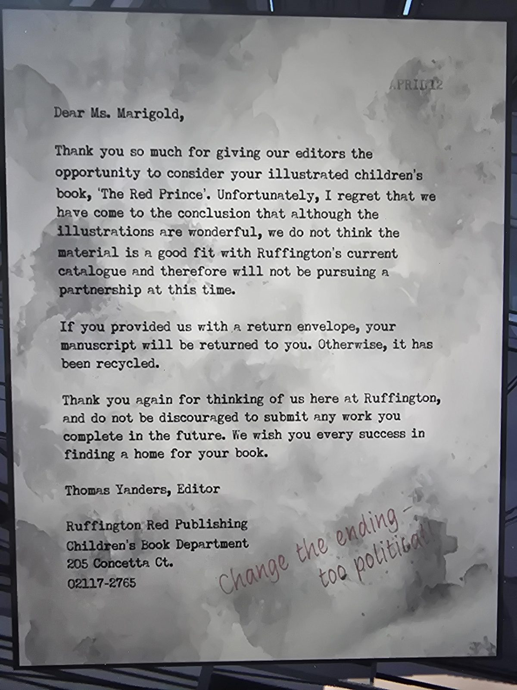

# Письмо-отказ от издательства Ruffington Red: «The Red Prince»
Attic. Печатное письмо на машинке; в правом верхнем углу штамп даты **«April 12»** (12 апреля; год не указан).

«Дорогая мисс **Мариголд**, спасибо, что дали нашим редакторам возможность рассмотреть вашу иллюстрированную детскую книгу «**The Red Prince**». К сожалению, мы пришли к выводу, что, хотя иллюстрации чудесные, материал не подходит под текущий каталог Ruffington, и мы **не будем предлагать сотрудничество**. Если вы приложили конверт для возврата, рукопись вернут; иначе она **переработана**. Не отчаивайтесь и присылайте будущие работы. Желаем найти дом для вашей книги.

**Томас Яндерс**, редактор
Ruffington Red Publishing, Children's Book Department, 205 Concetta Ct., 02117-2765»

**Красными чернилами от руки внизу справа:** «**Change the ending: too political!**» («Измените концовку: слишком политично!»)

## Заметка
- Marigold = псевдоним **Мэри Мэттью Джонс** (матери Саймона), см. [сюжет](../../../../story/timeline.md); «Red Prince» её дебютная детская книга ([в Nursery](../../../nursery/docs/the-red-prince-book/ru.md), [посвящение](../../../master-bedroom/docs/red-prince-dedication/ru.md)).
- Что именно в концовке «слишком политично», в письме не сказано; сверить с книгой в Nursery пока не делал (не проверено).
- Год письма неизвестен (виден только штамп «April 12»).

## Photos / Фото

