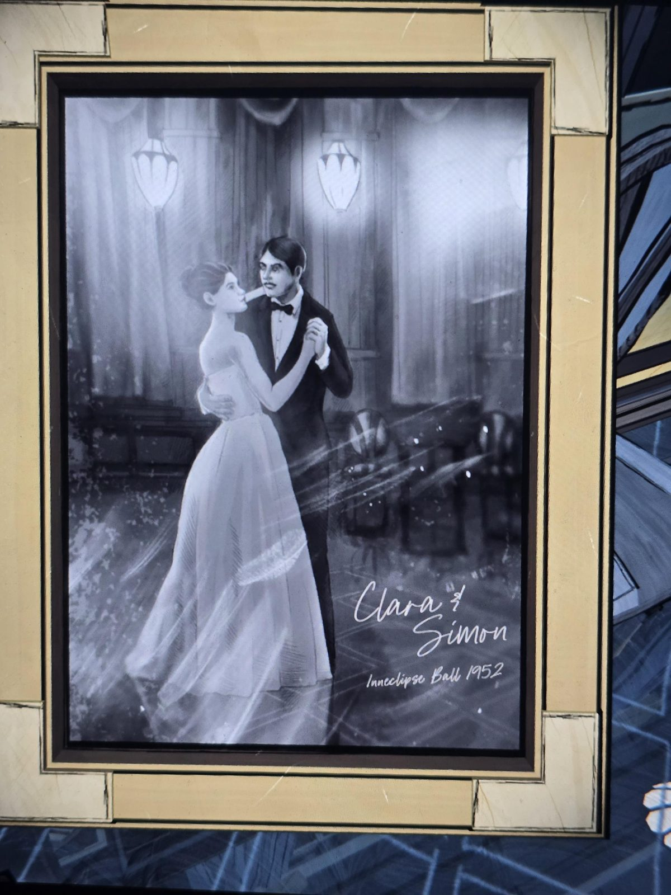

# Картина «Clara & Simon, Inneclipse Ball 1952»
Картина в Ballroom: пара танцует в бальном зале (женщина в белом платье, мужчина с усами во фраке). Подпись от руки:

**Клара и Саймон**
**Бал Inneclipse, 1952**

## Заметка
- Подтверждает: **Клара** (видимо, леди Клара Эпсен, умершая в 1983, см. [West Wing Hall](../../../west-wing-hall/docs/staff-notice-west-wing-closed/ru.md)) и **Саймон** (старший, брат Герберта?) — пара.
- Ср. ноты №6 и №7 (лежат в этой же комнате): «Under these stars, the dance is held», «Two remain for one last dance».

## Photos / Фото

