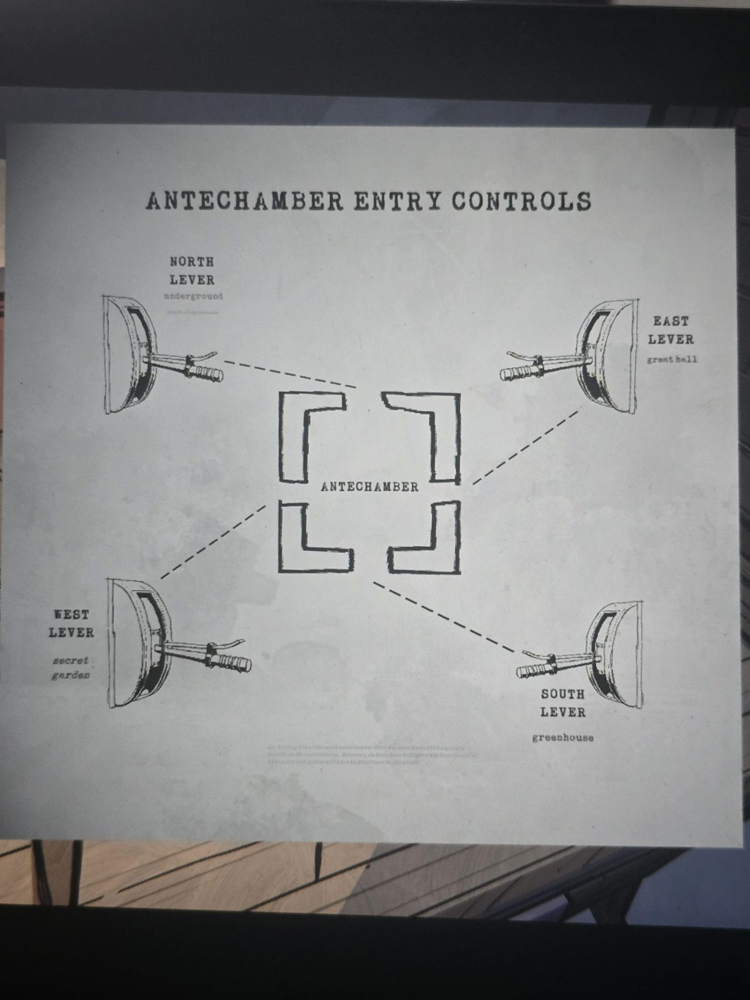

# Antechamber Entry Controls: схема рычагов
Найдена в [Basement](../../solutions.md). Схема: в центре [Antechamber](../../../antechamber/solutions.md), вокруг четыре рычага, соединённые пунктиром с четырьмя сторонами.

- **North lever**: underground (под ним ещё строка мелкого нечитаемого текста)
- **East lever**: great hall
- **West lever**: secret garden
- **South lever**: greenhouse

Мелкий шрифт внизу: «Для каждой двери Antechamber установлен один резервный рычаг в разных местах для надёжности. Однако нам сказали, что расположение этой резервной системы персоналу раскрыто не будет.»

## Заметка
- Совпадает с уже найденными рычагами: [Secret Garden](../../../secret-garden/solutions.md) (запад), [Great Hall](../../../great-hall/solutions.md) (восток), [Greenhouse](../../../greenhouse/solutions.md) (юг), [Inner Sanctum](../../../the-underpass/inner-sanctum.md) (север, underground).
- Значит, у каждой двери есть ещё **резервный рычаг**. Южный: [Weight Room](../../../weight-room/solutions.md).

## Photos / Фото

