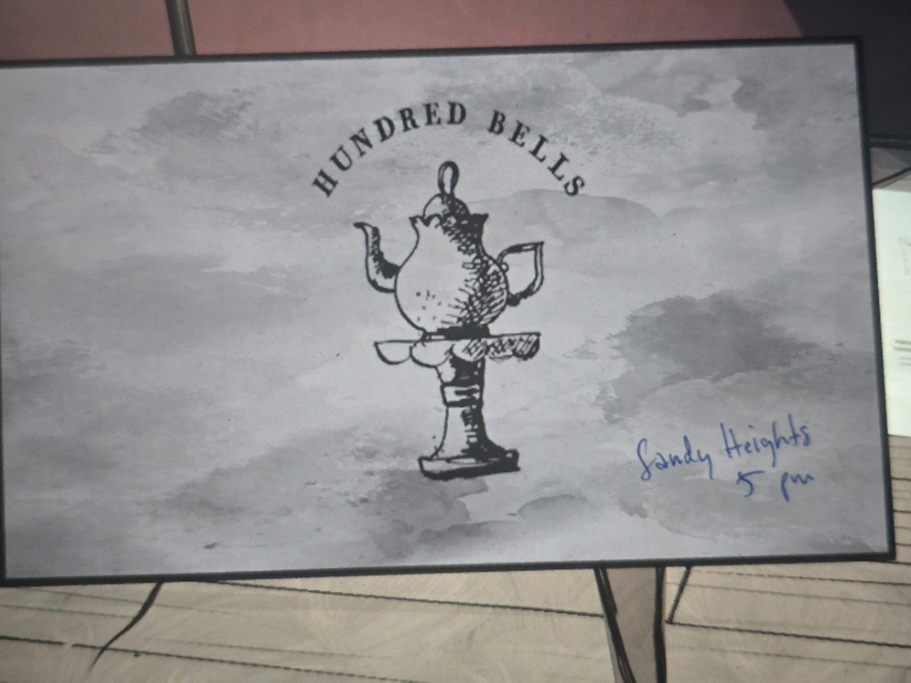

# Карточка «Hundred Bells»
Basement. Напечатанная карточка чайной **Hundred Bells** (чайник на постаменте). От руки синими чернилами: **«Sandy Heights, 5 pm»** («Сэнди-Хайтс, 5 вечера»).

## Заметка
- Найдена в [Basement](../../solutions.md).
- Hundred Bells: чайная в Тринсдейле, где в последний раз видели Мэри ([таймлайн](../../../../story/timeline.md)). Что такое Sandy Heights и чьё это приглашение, не установлено.

## Photos / Фото

