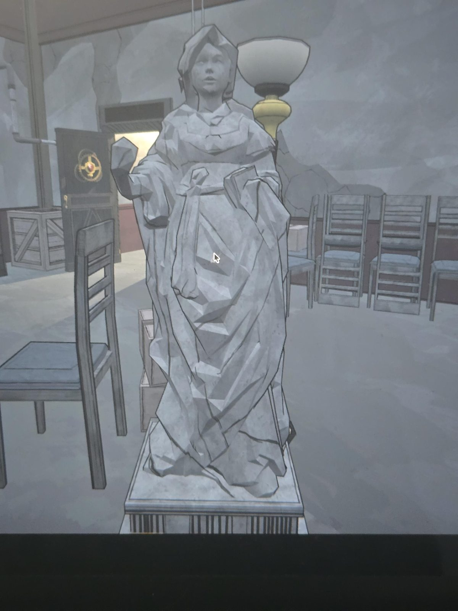
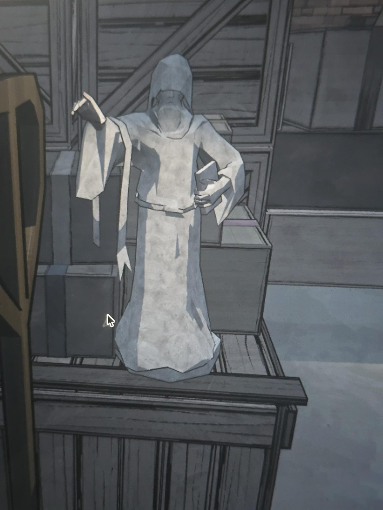

# Статуи в Basement
Две белые статуи, надписей нет; со слов пользователя, похожи на [статуи в Chapel](../../../chapel/docs/statues/ru.md).

1. Женщина с покрытой головой (платок/капюшон): одна рука поднята, в другой книга. Стоит на постаменте, рядом лампа.
2. Фигура в плаще с капюшоном, лицо скрыто (возможно, борода): одна рука поднята, вторая прижимает книгу к поясу. Стоит на деревянном ящике среди коробок.

## Заметка
- Поза и книга повторяются у обеих. Связь с Chapel и что делают поднятые руки, не установлено.

## Photos / Фото

