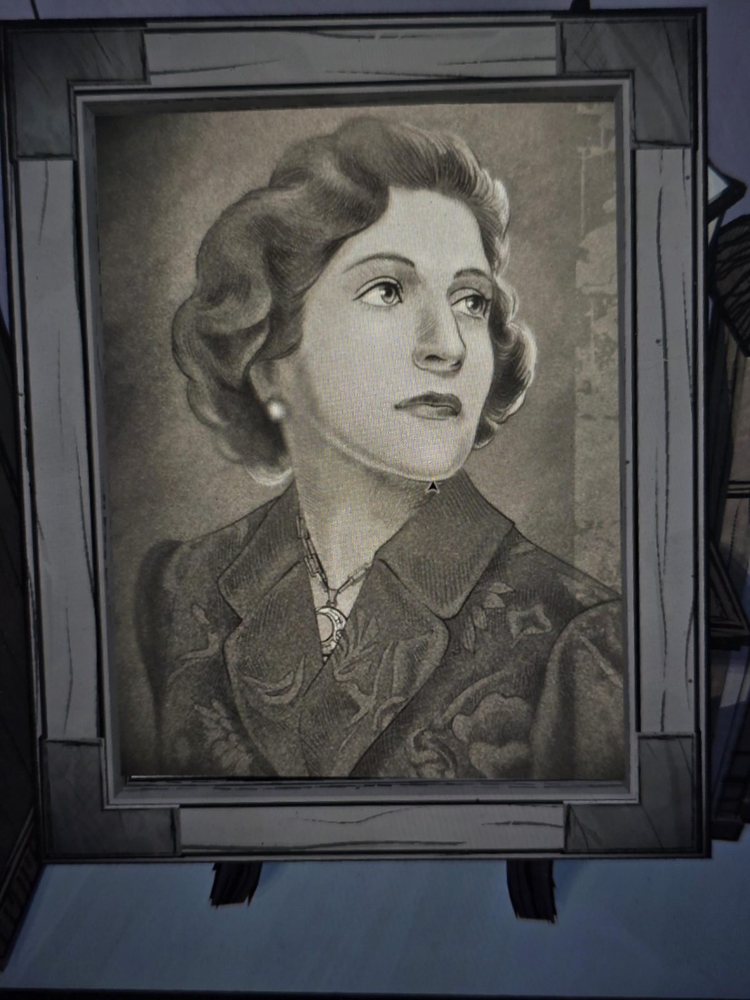

# Портрет женщины с подвеской-луной
Портрет в рамке на подставке в Bedroom, без подписи. Женщина с уложенными волнами волосами (мода 1930–40-х), жемчужная серьга, жакет с узором, на шее **подвеска в форме полумесяца**.

## Заметка
- Это **баронесса Ауравей**, жена барона Томаса Синклера, мать Герберта и Саймона Х. (см. [древо](../../../root-cellar/docs/mount-holly-family-tree/ru.md)). Подвеску-луну стоит запомнить: может пригодиться для опознания на других портретах и в документах.

## Photos / Фото

