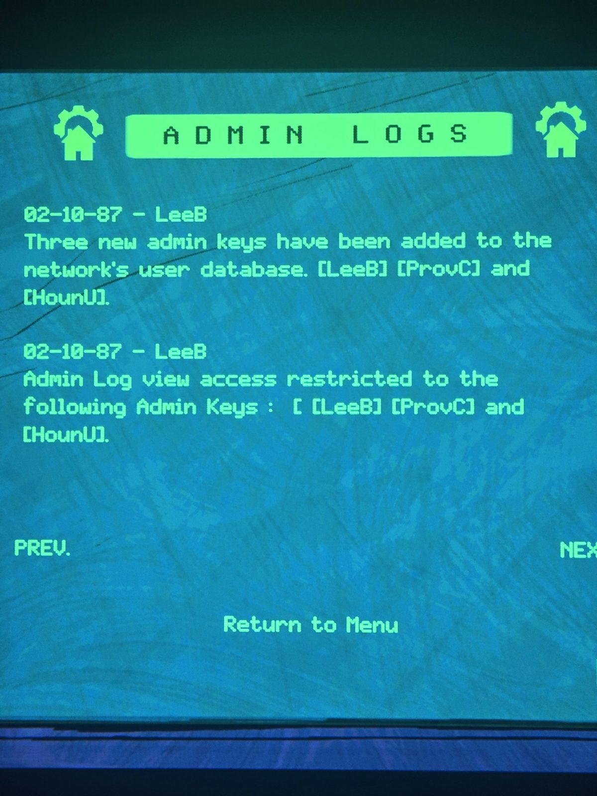
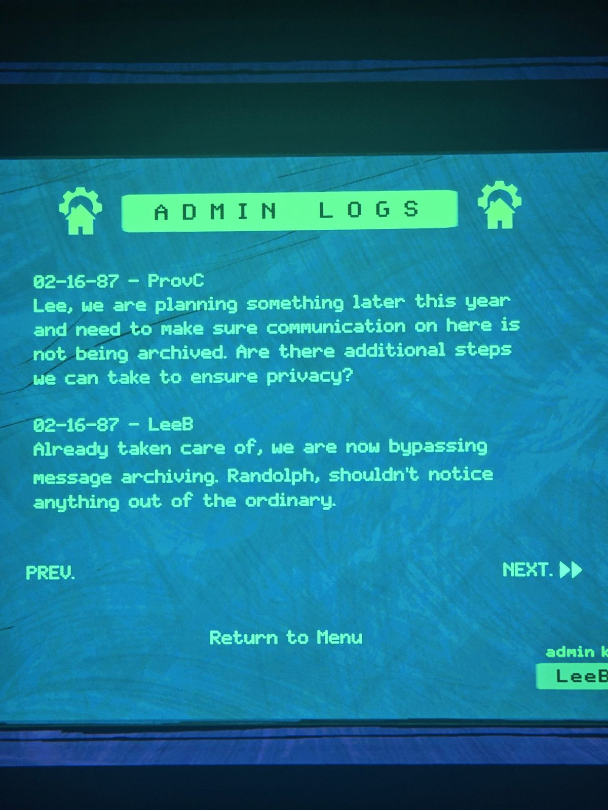
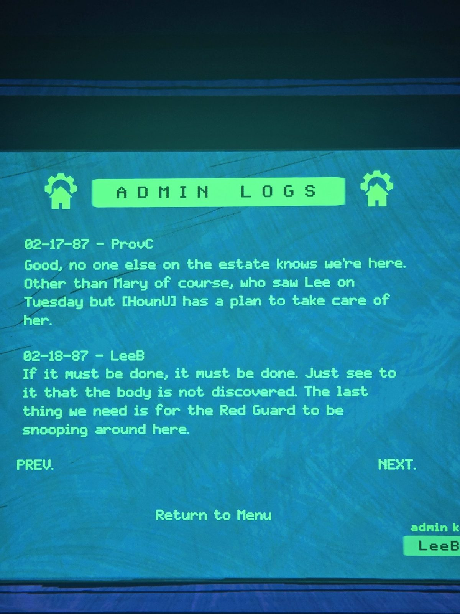
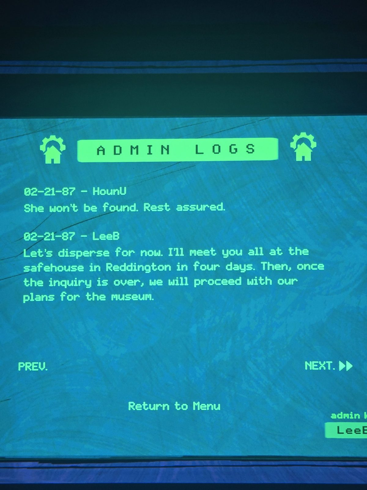
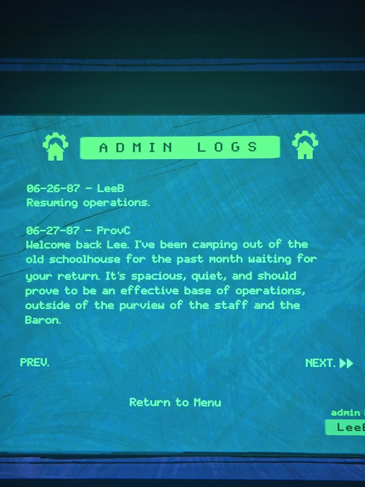
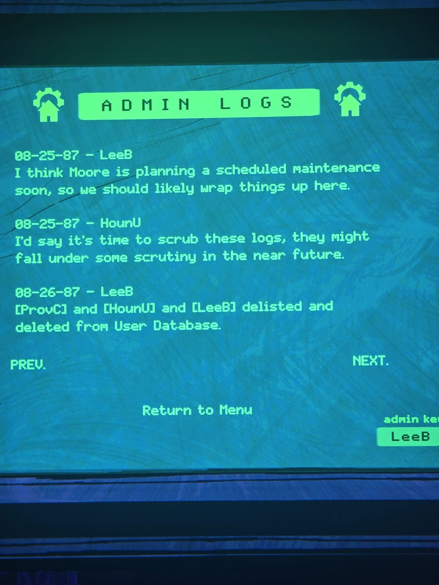

# Hidden logs visible with key LeeB
02-10-87 LeeB — Three new admin keys have been added to the network's user database. [LeeB] [ProvC] and [HounU].
02-10-87 LeeB — Admin Log view access restricted to the following Admin Keys: [LeeB] [ProvC] and [HounU].
02-16-87 ProvC — Lee, we are planning something later this year and need to make sure communication on here is not being archived. Are there additional steps we can take to ensure privacy?
02-16-87 LeeB — Already taken care of, we are now bypassing message archiving. Randolph shouldn't notice anything out of the ordinary.
02-17-87 ProvC — Good, no one else on the estate knows we're here. Other than Mary of course, who saw Lee on Tuesday but [HounU] has a plan to take care of her.
02-18-87 LeeB — If it must be done, it must be done. Just see to it that the body is not discovered. The last thing we need is for the Red Guard to be snooping around here.
02-21-87 HounU — She won't be found. Rest assured.
02-21-87 LeeB — Let's disperse for now. I'll meet you all at the safehouse in Reddington in four days. Then, once the inquiry is over, we will proceed with our plans for the museum.
06-26-87 LeeB — Resuming operations.
06-27-87 ProvC — Welcome back Lee. I've been camping out of the old schoolhouse for the past month waiting for your return. It's spacious, quiet, and should prove to be an effective base of operations, outside of the purview of the staff and the Baron.
07-10-87 LeeB — We should have an opening on the first day of September. Can we be ready by then?
07-13-87 HounU — I don't see why not. Negotiations for transportation are in the final stages. If all goes well we will have air passage to Nuance secured for that date.
08-25-87 LeeB — I think Moore is planning a scheduled maintenance soon, so we should likely wrap things up here.
08-25-87 HounU — I'd say it's time to scrub these logs, they might fall under some scrutiny in the near future.
08-26-87 LeeB — [ProvC] and [HounU] and [LeeB] delisted and deleted from User Database.

## Photos / Фото

