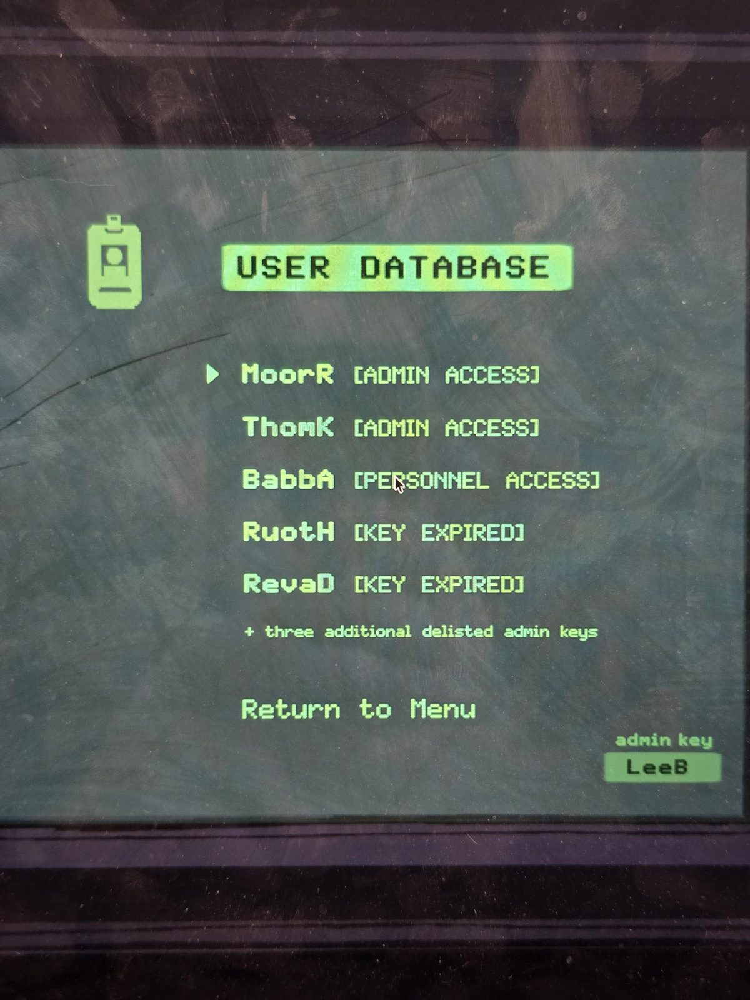

# База пользователей (User Database)
Экран терминала в [Blackbridge Grotto](../../solutions.md). В углу экрана: «admin key: **LeeB**» (текущий ключ).

| Ключ | Статус |
|---|---|
| MoorR (Мур) | ADMIN ACCESS (полный доступ) |
| ThomK | ADMIN ACCESS |
| BabbA (Бэббидж) | PERSONNEL ACCESS (доступ к базе пользователей) |
| RuotH | KEY EXPIRED (ключ истёк) |
| RevaD | KEY EXPIRED |

+ ещё **три исключённых админских ключа** (по логам: LeeB, ProvC, HounU).

## Заметка
- Права доступа расписаны в [логе от 07-03-91](../admin-logs/ru.md).

## Photos / Фото

