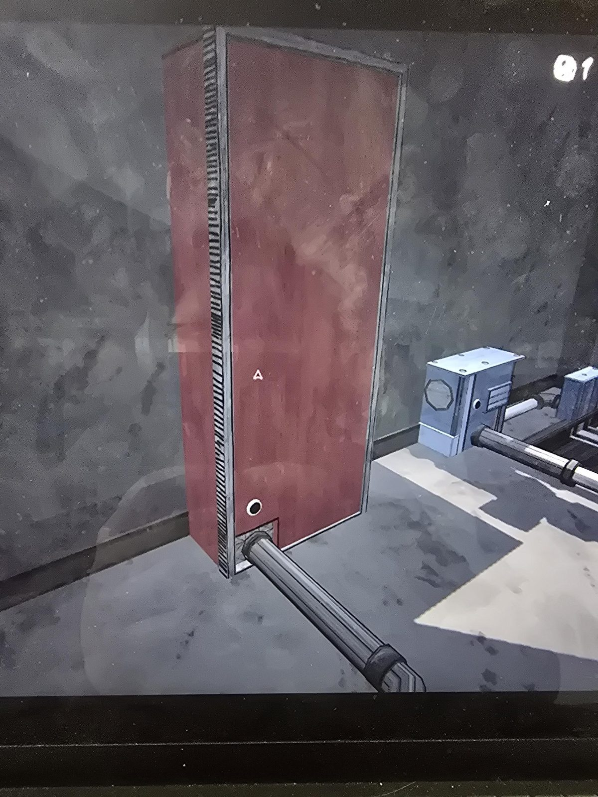

# Boiler Room: решения

- **Красный блок** (высокий красный бак/щиток с трубой у основания и тёмным отверстием внизу), рядом синие коробки с трубами. Нужен для комнат с машинами, как [Laboratory](../laboratory/solutions.md): см. [питание от Boiler Room](../../puzzles/boiler-power.md).

## Фото

