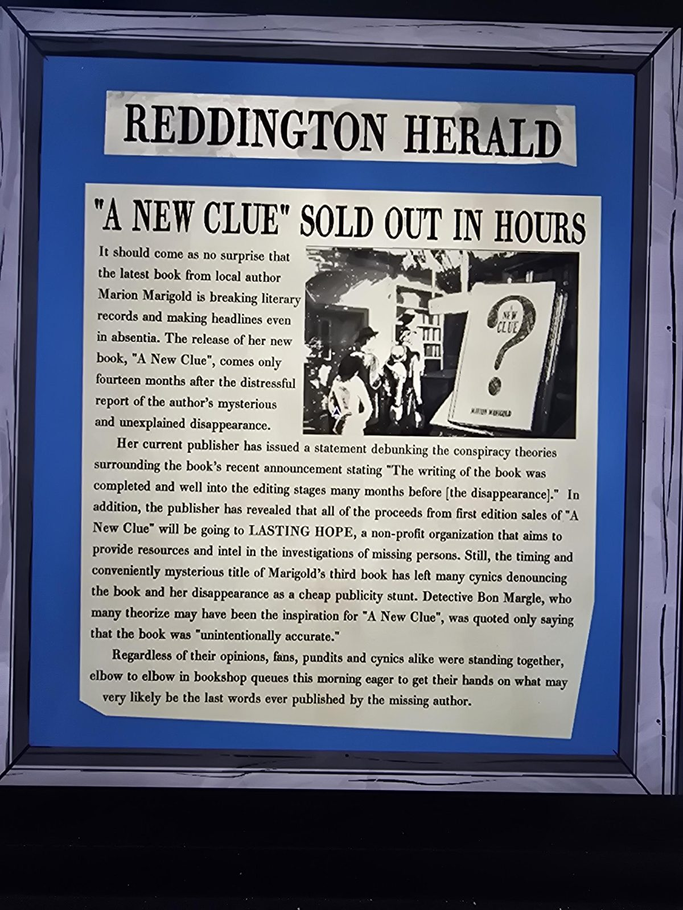

# Reddington Herald: «A New Clue» раскуплена за часы
Вырезка в рамке в Bookshop.

**«A NEW CLUE» РАСКУПЛЕНА ЗА ЧАСЫ**

Неудивительно, что последняя книга местного автора **Марион Мэриголд** бьёт литературные рекорды и попадает в заголовки даже в её отсутствие. Выход новой книги **«A New Clue»** случился всего через **четырнадцать месяцев** после тревожного сообщения о загадочном и необъяснённом **исчезновении** автора.

Нынешнее издательство выступило с заявлением, опровергающим теории заговора вокруг недавнего анонса: «Написание книги было завершено и находилось на стадии редактуры за много месяцев до [исчезновения]». Кроме того, издательство раскрыло, что вся выручка от продаж **первого издания** пойдёт организации **LASTING HOPE** — некоммерческой, помогающей ресурсами и информацией в расследованиях пропавших без вести. Тем не менее время выхода и «удобно загадочное» название **третьей** книги Мэриголд побудило многих циников назвать книгу и исчезновение дешёвым рекламным ходом. **Детектив Бон Маргл**, который, как полагают многие, мог стать прообразом «A New Clue», сказал лишь, что книга «**непреднамеренно точна**».

Независимо от мнений, поклонники, обозреватели и циники стояли плечом к плечу в очередях в книжные магазины этим утром, стремясь заполучить то, что весьма вероятно станет последними словами, опубликованными пропавшим автором.

## Заметка
- Согласуется с линией Мэри: Марион Мэриголд — автор [«The Red Prince»](../../../nursery/docs/the-red-prince-book/ru.md) и [«Swim Bird»](../../../library/books/swim-bird/ru.md); исчезновение 20 февр. '87 ([timeline](../../../../story/timeline.md)), значит, «A New Clue» вышла примерно через 14 месяцев. Прямо в статье Мэри не названа.
- Книга «A New Clue» продаётся в [Bookshop](../../solutions.md) (50 монет), [текст книги](../../../library/books/a-new-clue/ru.md).
- Маргл (REDGUARD): [письмо и книга](../../../library/books/the-history-of-orindia/letter-margle/ru.md).

## Photos / Фото

