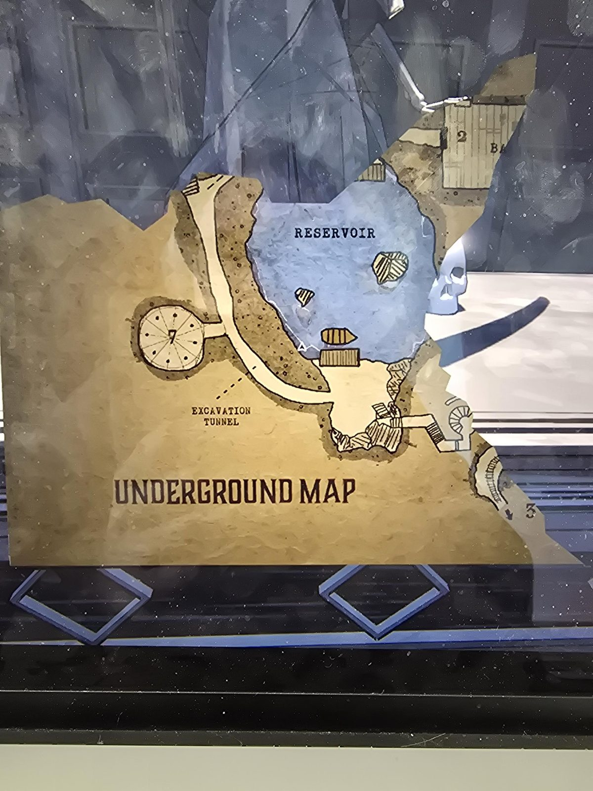

# Подземная карта: фрагмент (Catacombs)
Оторванный кусок карты **Underground Map** в Catacombs. Видны:
- **Reservoir** (резервуар): озеро с двумя островками и лодкой, причал у южного берега.
- **Excavation Tunnel** (раскопочный туннель): длинный изогнутый туннель вдоль западного берега резервуара.
- **7**: круглая комната со спицами и точками, слева от туннеля.
- **2**: комната вверху справа (подпись оборвана, «BA…»).
- **3**: винтовая лестница/путь со стрелкой внизу справа.

## Заметка
- Остальные части карты оторваны (за краем снимка виден скелет статуи смерти).
- Резервуар и «старые туннели» упоминаются в [письме про шахту](../../../gemstone-cavern/docs/new-mine-equipment-letter/ru.md) (вагонетка со стороны резервуара).
- Полная карта была в первом прохождении (ветка `old`, `documents/underground-map`); здесь записан только этот фрагмент.

## Photos / Фото

