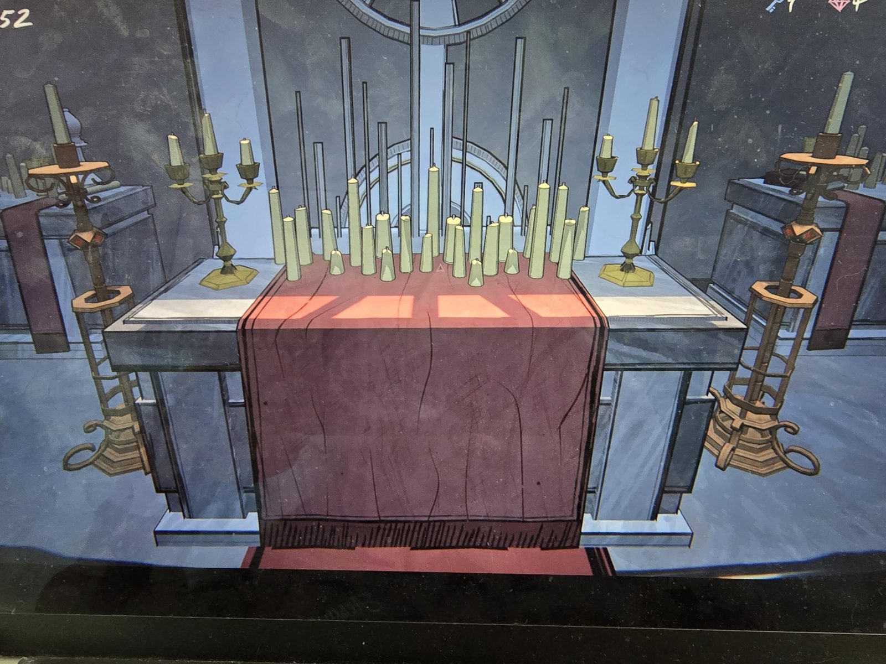
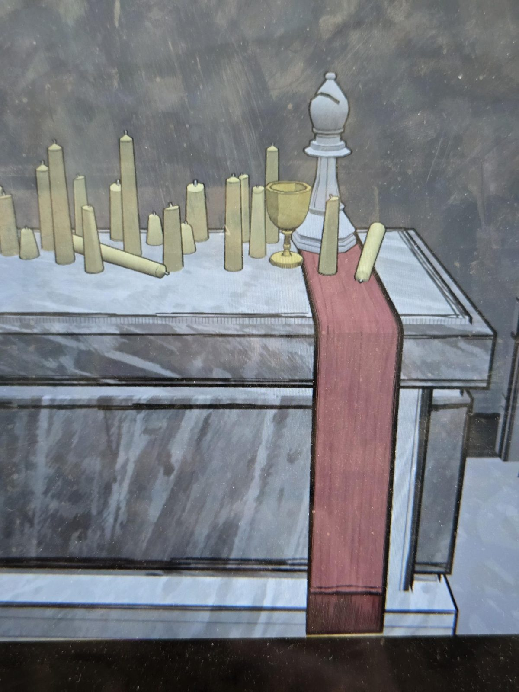

# Алтарь и свечи
Главный алтарь с красной дорожкой и множеством свечей, которые **можно зажигать**. По бокам канделябры и высокие подсвечники. На боковом алтаре свечи, золотая чаша и **белый шахматный слон**.

## Заметка
- Свечи зажигаются. Зачем, пока неизвестно (см. [open-questions](../../open-questions.md)).
- Слон записан в [шахматы](../../../../puzzles/chess/README.md).

## Photos / Фото

