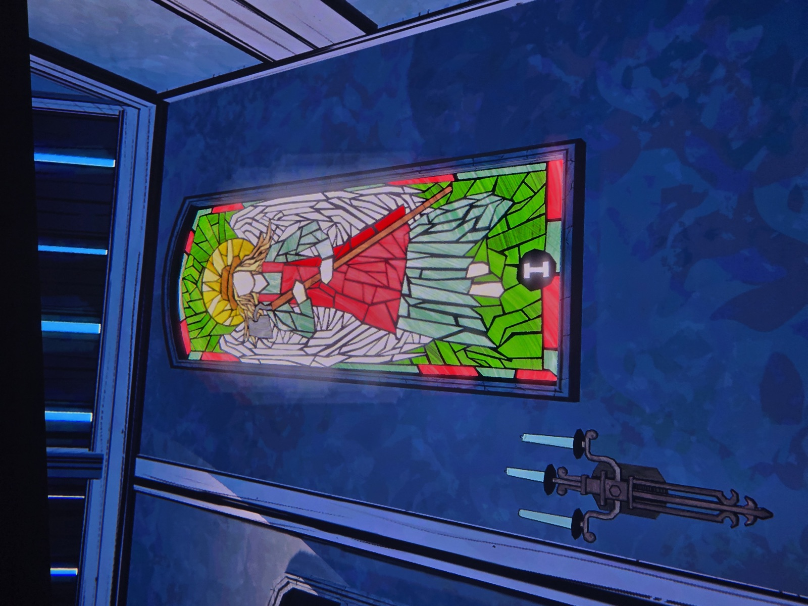
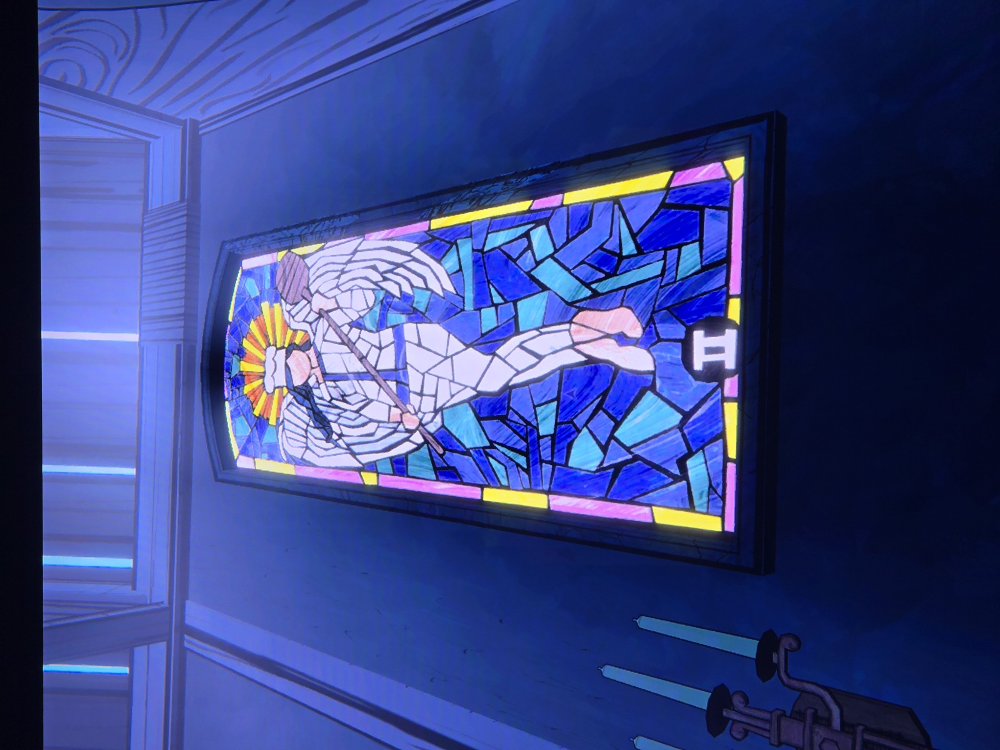
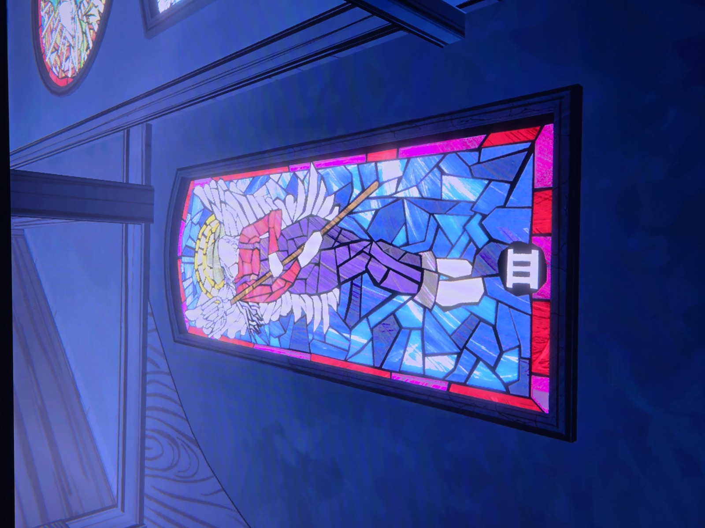
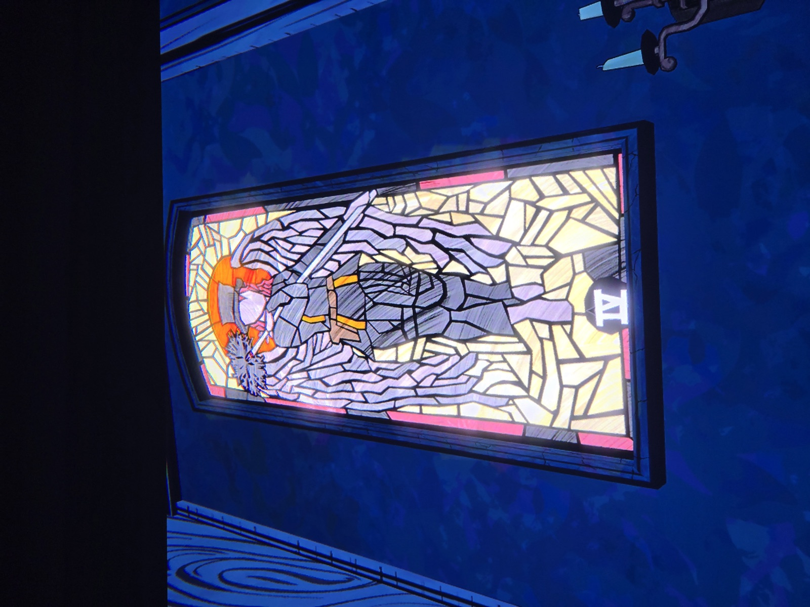
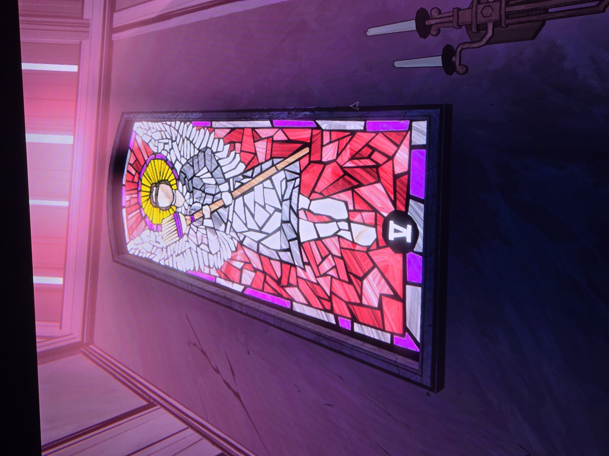
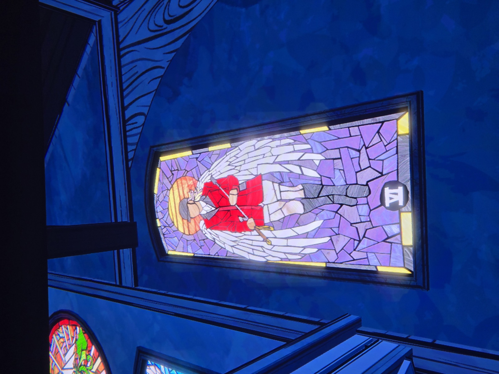
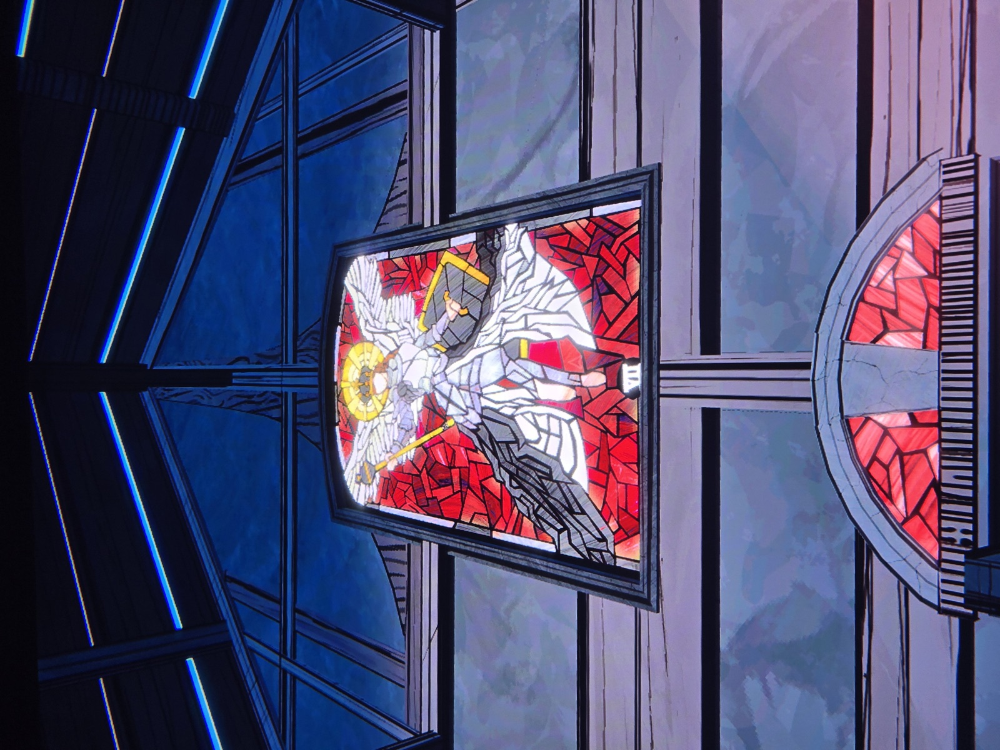

Семь витражей I–VII: I садовник с мотыгой · II повар с лопаткой · III фермер/работник с вилами · IV трубочист · V горничная с метлой · VI охотник/наездник в красном с хлыстом · VII коронованная фигура со скипетром и книгой (король).
Нимбы чередуются: жёлтый (I, III, V, VII) и оранжевый (II, IV, VI).

*Заметка: шесть слуг и правитель — возможно, отсылка к профессиям персонала или к загадке. Назначение пока неизвестно.*

## Photos / Фото

