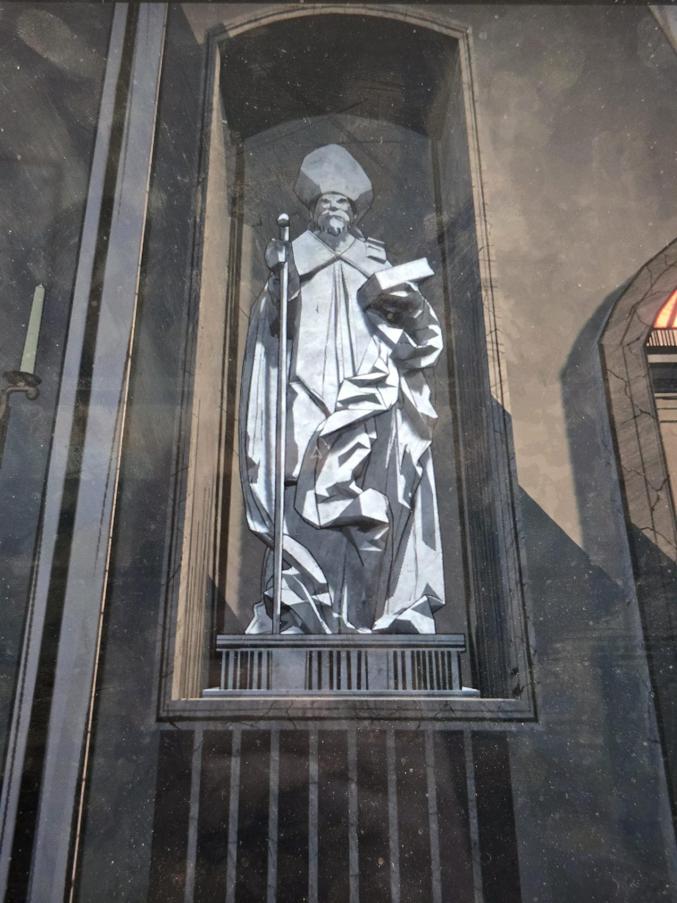
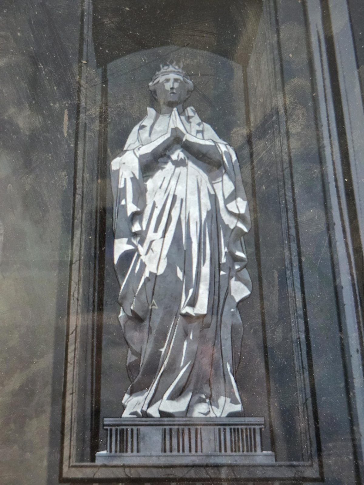
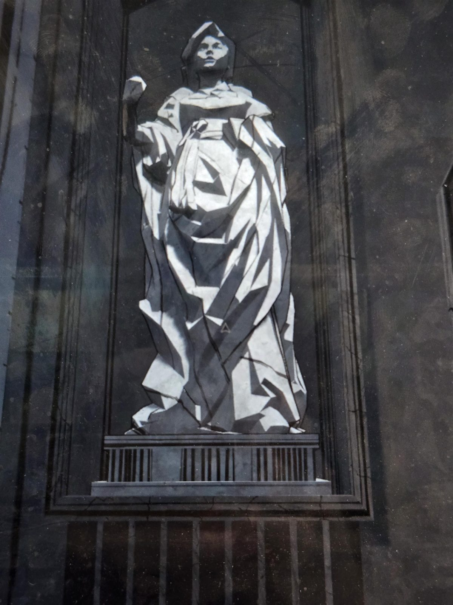
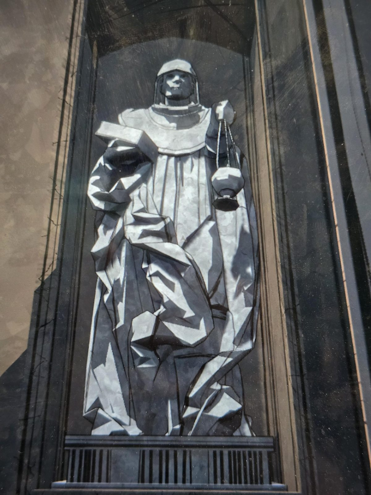

# Статуи в нишах
Четыре мраморные статуи, надписей нет.

1. Бородатый **епископ** в митре, с посохом и книгой.
2. **Коронованная женщина** со сложенными в молитве руками.
3. **Женщина в платке/капюшоне**, поднимает круглый предмет (камень? плод?).
4. **Бородатый мужчина в капюшоне** с кадилом на цепях.

## Заметка
- Кто они и зачем, пока неизвестно.

## Photos / Фото

