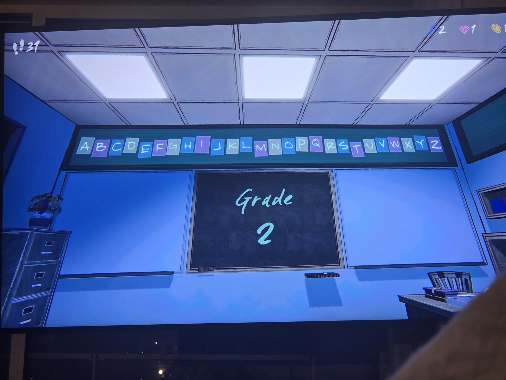

Над доской — алфавит A–Z на карточках трёх цветов (серые, фиолетовые, синие); на доске «Grade 2».
*Заметка: как и карточки с числами (1–10, ∞ вместо 8), цвета могут что-то кодировать. Цвета на фото различимы плохо — переснять при случае.*

## Photos / Фото

