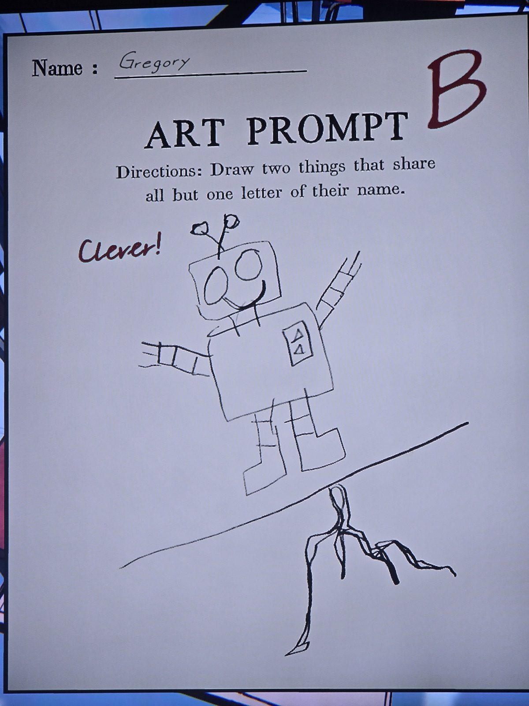
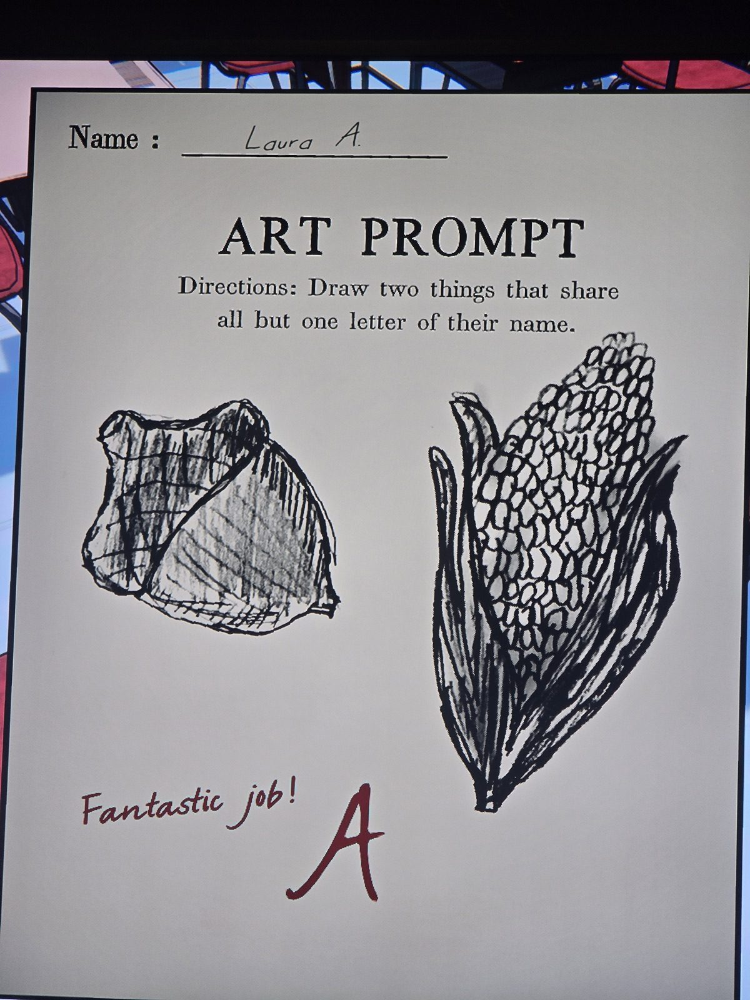
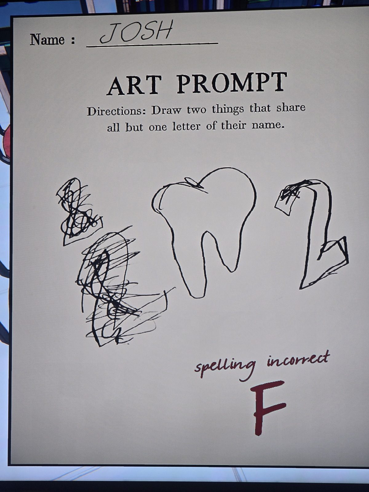

Листы «Задание по рисованию: нарисуй две вещи, названия которых отличаются одной буквой» — та же механика, что у пар картинок по клеткам:
1. Грегори (B, «Умно!»): робот и корни — **ROBOT / ROOT**.
2. Лора А. (A): жёлудь и кукуруза — **ACORN / CORN**.
3. Джош (F, «ошибка в написании»): зуб и «2» — TOOTH / TWO (не по правилу).
*Комната — предположительно Classroom.*

## Photos / Фото

