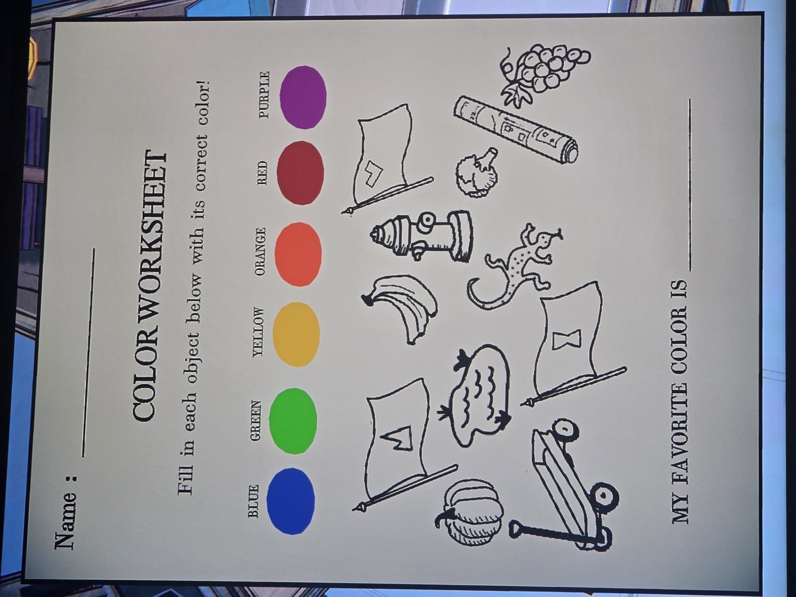
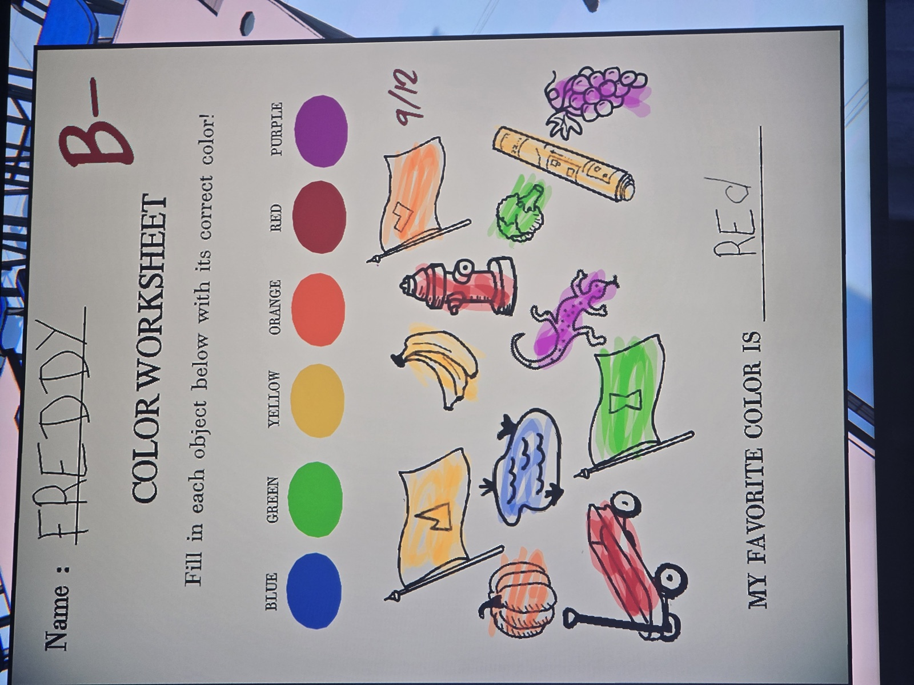
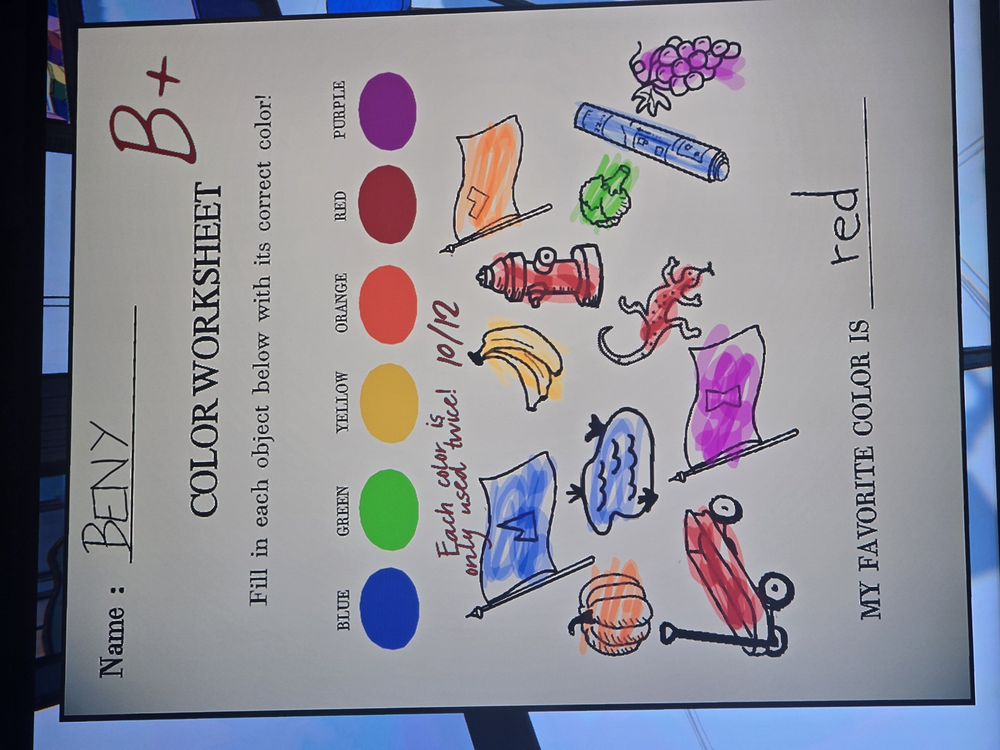
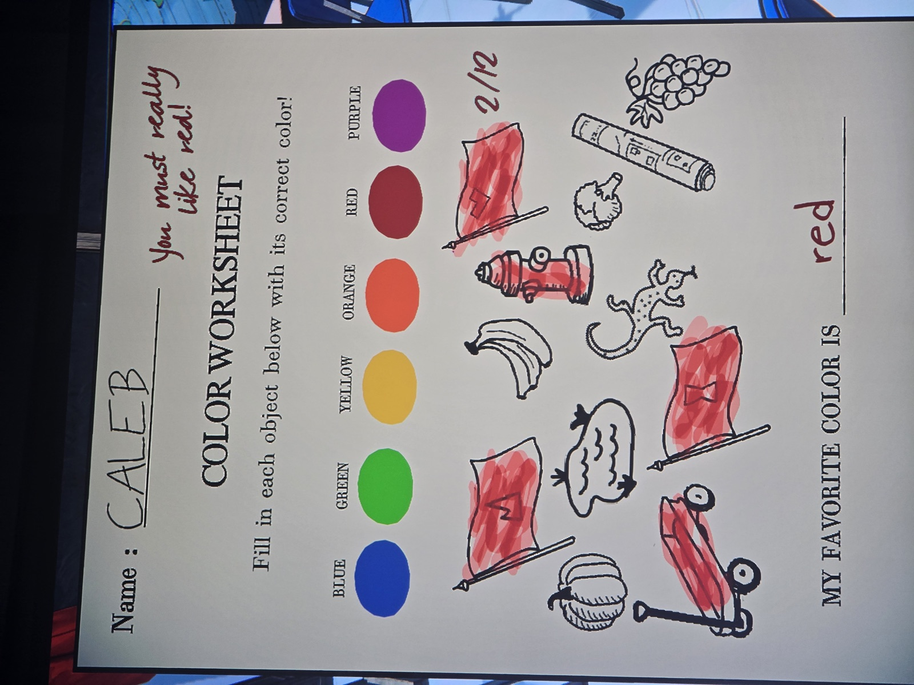

COLOR WORKSHEET — Directions: Color each item. (Items: flag with mountain/crown symbol, banana, fire hydrant, flag with heart/chevron symbol, pumpkin, pond with ducks, lizard, broccoli, crayon, grapes, wagon, flag with hourglass symbol.) "My favorite color is ___".

01 — blank worksheet.
02 — Freddy, B- (9/12): mountain-flag yellow, banana yellow, hydrant red, heart-flag orange, pumpkin orange, pond blue, lizard purple, broccoli green, crayon yellow, grapes purple, wagon red, hourglass-flag green. Favourite: RED.
03 — Beny, B+ (10/12), teacher's note "Each color is only used twice!": mountain-flag blue, banana yellow, hydrant red, heart-flag orange, pumpkin orange, pond blue, lizard red, broccoli green, crayon blue, grapes purple, wagon red, hourglass-flag purple. Favourite: red.
04 — Caleb (2/12), teacher's note "You must really like red!": everything red. Favourite: red.

## Photos / Фото

