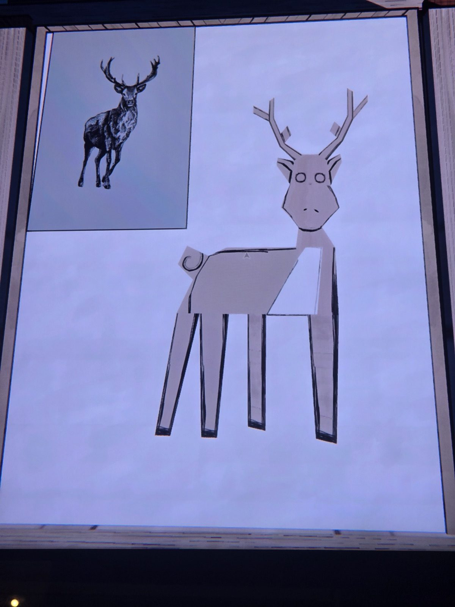
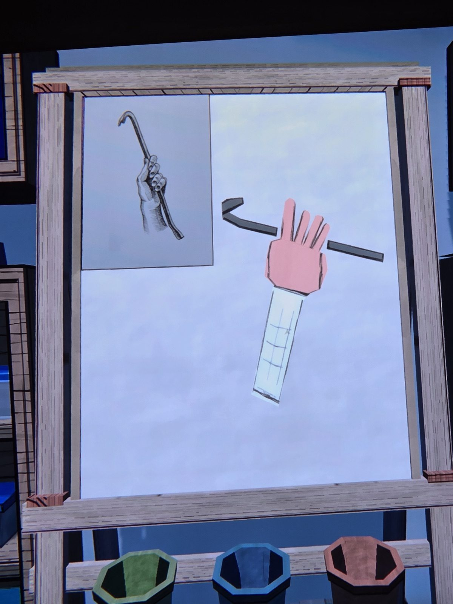
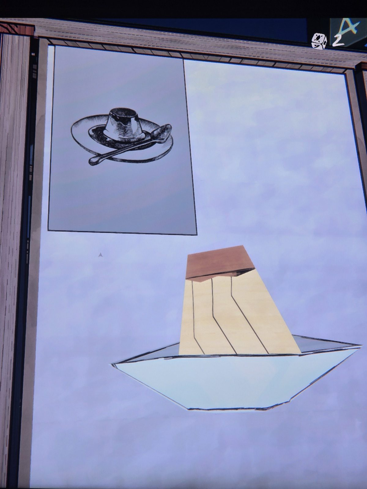
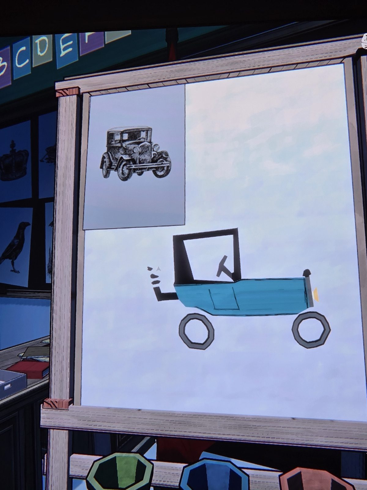
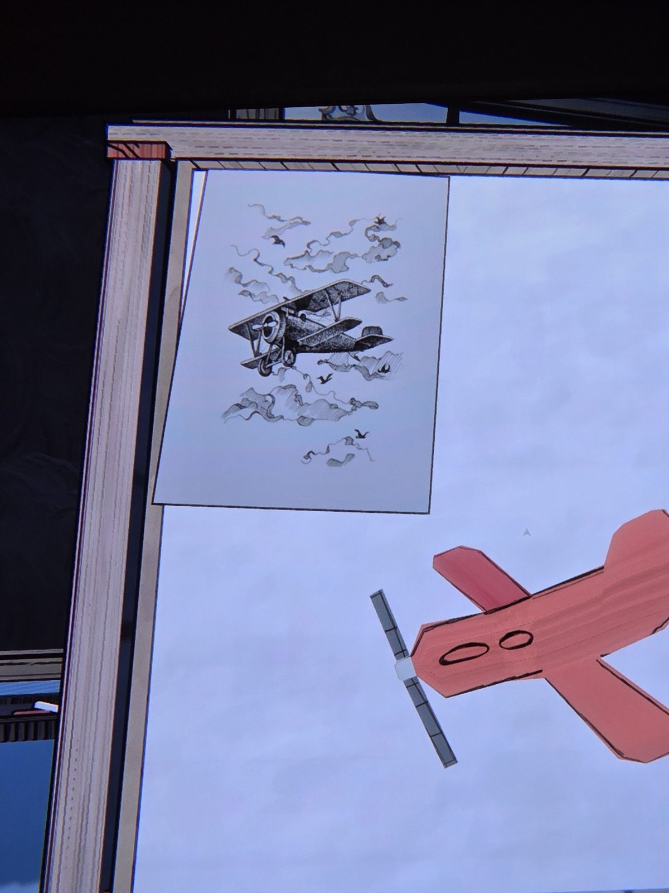
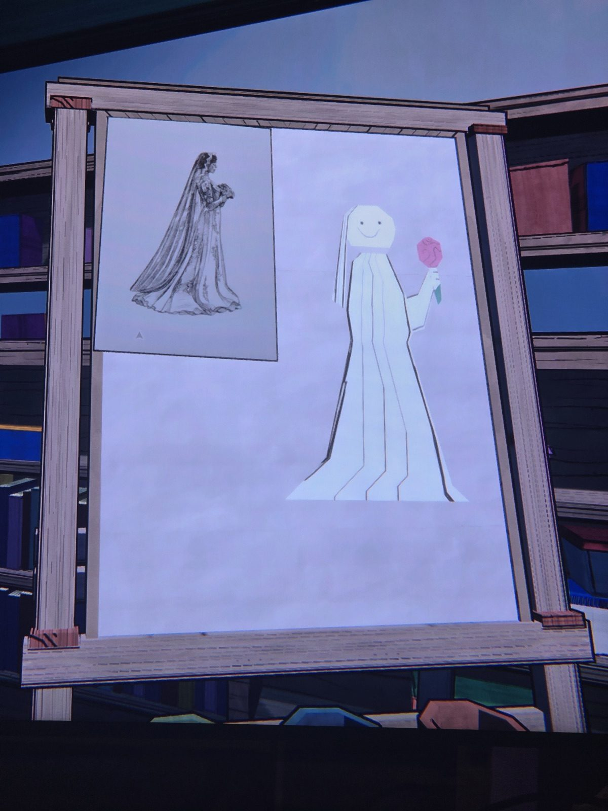

Six easels, each with a reference picture pinned in the corner and a child's painting of it:
01 — stag · 02 — hand with a crowbar (pry) · 03 — flan on a plate · 04 — vintage car · 05 — biplane · 06 — bride.
(Paint pots green / blue / red under the easels; alphabet cards visible behind.)

## Photos / Фото

