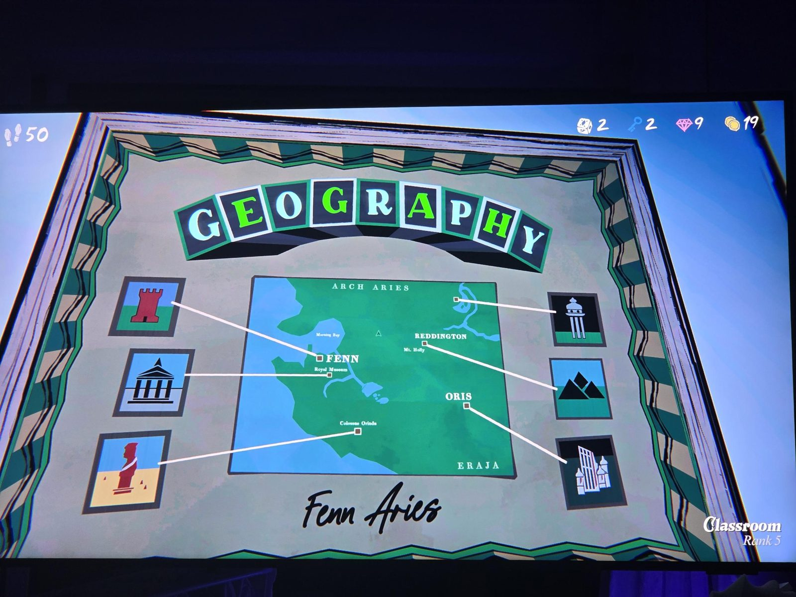

GEOGRAPHY poster — "Fenn Aries". Map with Arch Aries (north), Morning Bay, FENN (+ Royal Museum), REDDINGTON (Mt. Holly), ORIS, Colossus Orinda, ERAJA (south-east). Icons: red tower (Fenn), temple (Royal Museum), red statue (Colossus Orinda), pillar monument, black mountains (Reddington), white castle (Oris).

## Photos / Фото

