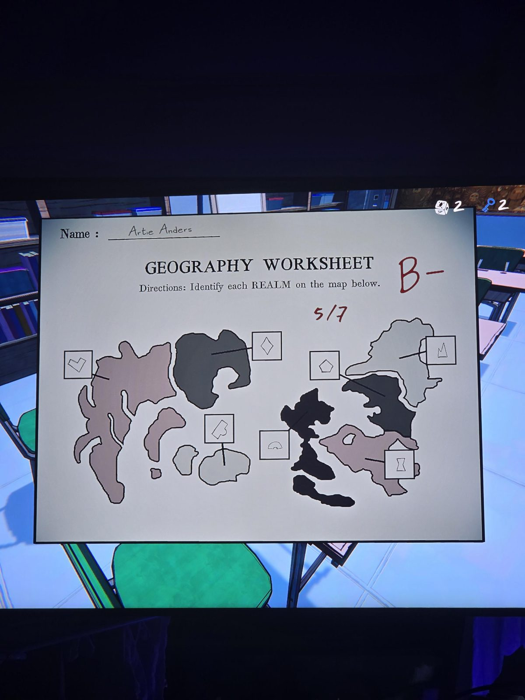
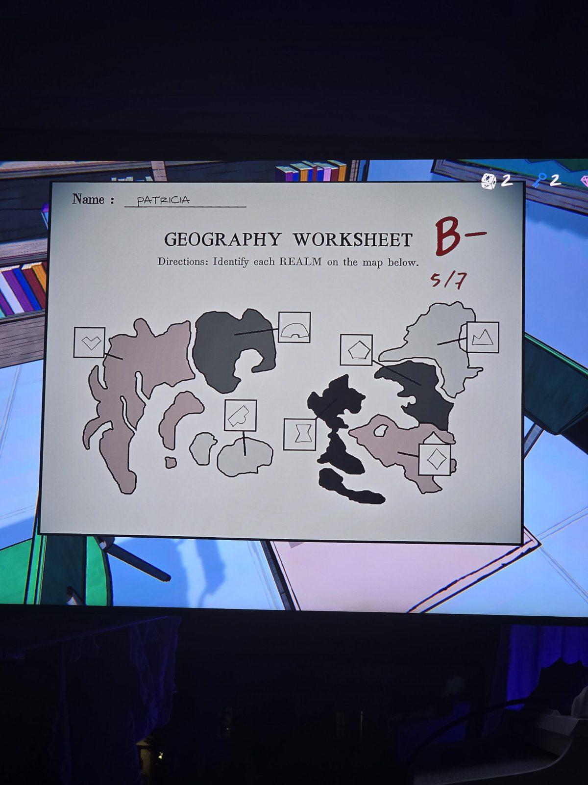
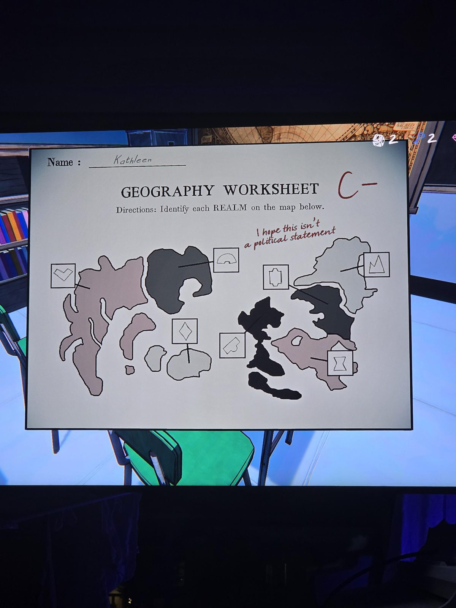

GEOGRAPHY WORKSHEET — Directions: Identify each REALM on the map below.
Three students: Artie Anders (B-, 5/7), Patricia (B-, 5/7), Kathleen (C-, "I hope this isn't a political statement").
Each labels 8 realms with symbols (heart, pentagon, mountain, diamond, dome, hourglass, hexagon, club-tile). Answers differ between students → none is fully correct.

## Photos / Фото

