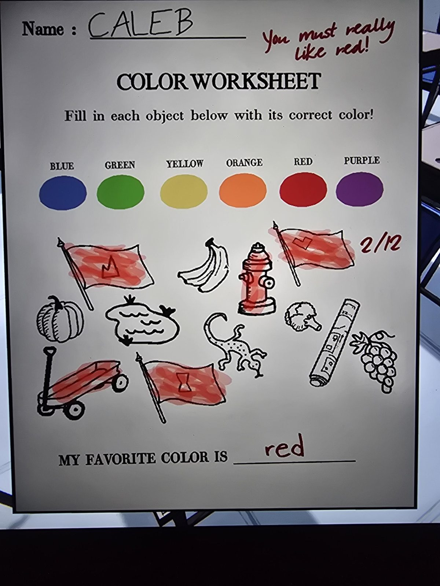
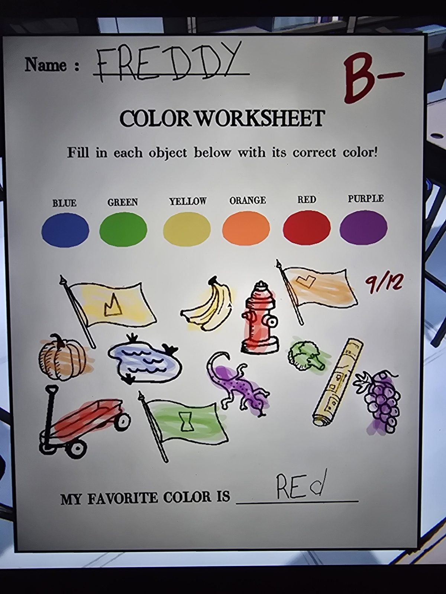
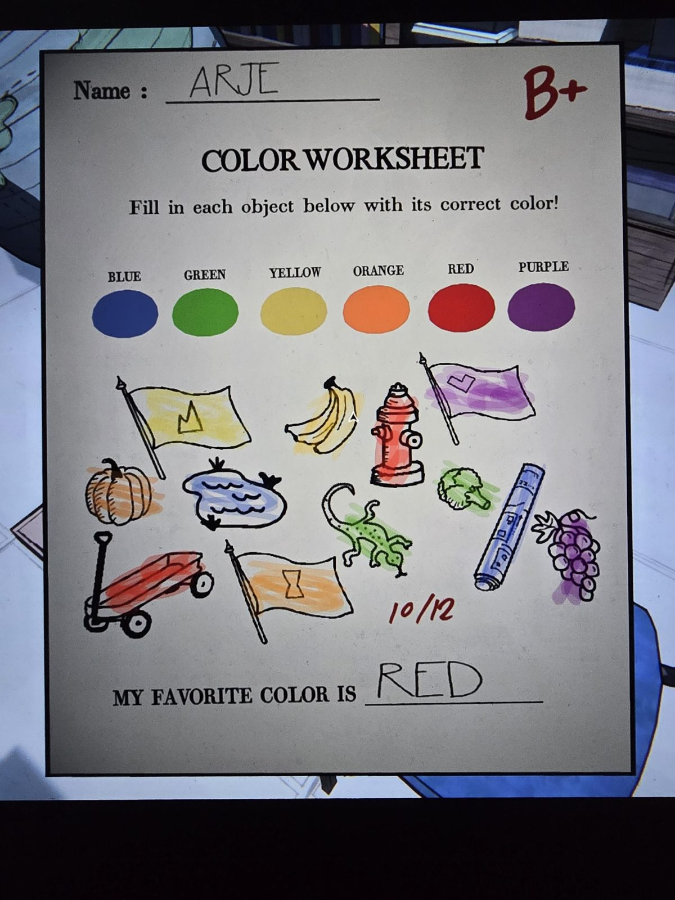

# Grade 1: листы-раскраски «Color Worksheet»
Classroom, **1-й класс** (Grade 1). Задание: «Раскрась каждый предмет правильным цветом!» Палитра: синий, зелёный, жёлтый, оранжевый, красный, фиолетовый. 12 предметов, в т.ч. **три флага с эмблемами**.

| Предмет | CALEB (2/12) | FREDDY (B−, 9/12) | ARJE (B+, 10/12) |
|---|---|---|---|
| Флаг с «короной» | красный | жёлтый | жёлтый |
| Бананы | — | жёлтые | жёлтые |
| Пожарный гидрант | красный | красный | красный |
| Флаг с «галочкой» | красный | оранжевый | фиолетовый |
| Тыква | — | оранжевая | оранжевая |
| Пруд с утками | — | синий | синий |
| Ящерица | — | фиолетовая | зелёная |
| Брокколи | — | зелёная | зелёная |
| Маркер | — | жёлтый | синий |
| Виноград | — | фиолетовый | фиолетовый |
| Тележка | красная | красная | красная |
| Флаг с «песочными часами» | красный | зелёный | оранжевый |
| Любимый цвет | red | RED | RED |

Учитель Калебу: «Ты, должно быть, очень любишь красный!»

## Заметка
- Эмблемы на флагах — это **ядра печатей королевств** из [книги о печатях](../../../the-precipice/docs/realm-sigils-book/ru.md): корона = **Ar[...]**, галочка = **Co[...]**, песочные часы = **Er[...]**. Значит, по оценкам (9/12 и 10/12) можно вычислить **цвета флагов этих королевств** (= цвет каймы на их печатях).
- **Caleb** любит красный — ср. **Калеб Мэннинг**, наставник Мэри.
- Все трое пишут любимый цвет «красный».

## Photos / Фото

