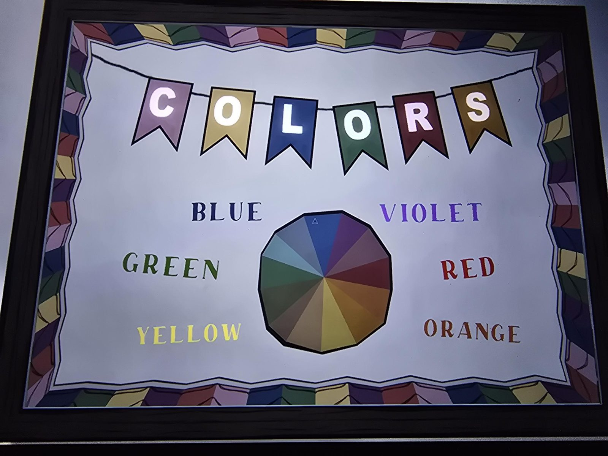

# Grade 1: плакат «COLORS»
Плакат в Classroom (1-й класс): гирлянда флажков C-O-L-O-R-S (розовый, жёлтый, синий, зелёный, красный, оранжевый) и цветовой круг с подписями: синий, фиолетовый, зелёный, красный, жёлтый, оранжевый.

## Photos / Фото

